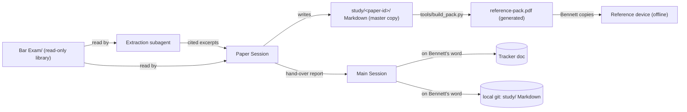
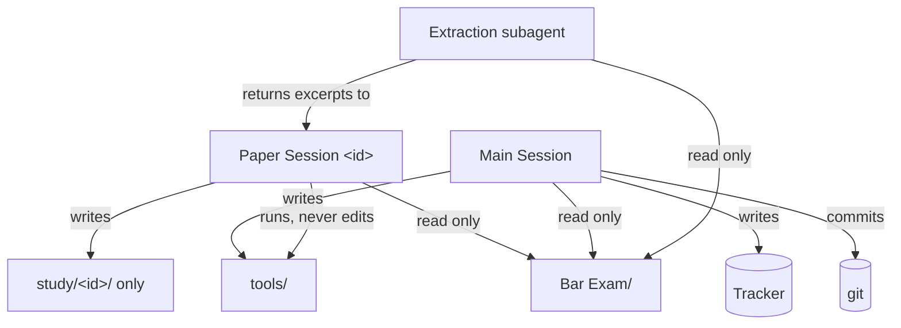
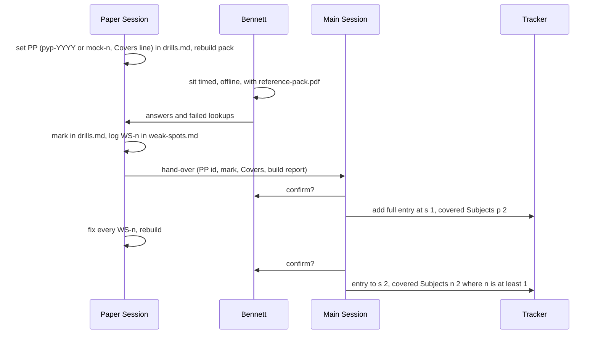

# Architecture Spine — Part B Bar Exam Helper

## Design Paradigm

**Pipes and filters.** Each stage reads the one before it and writes only its own output. No stage edits upstream. This ratifies the pattern `study/eth-w/` already runs. Paper Sessions read this file after `SCHEMA.md`; it is the authority on the `study/` file set and formats.



| Stage | Lives in | Writer |
| --- | --- | --- |
| Source library | `Bar Exam/` | nobody (read-only) |
| Coverage List | `study/<paper-id>/coverage.md` | that Paper's Paper Session |
| Content | `study/<paper-id>/{prewrites,templates,flowcharts}.md` | that Paper's Paper Session |
| Working files | `study/<paper-id>/{question-bank,drills,weak-spots}.md` | that Paper's Paper Session |
| Build step | `tools/build_pack.py` | Main Session |
| Reference Pack | `study/<paper-id>/reference-pack.pdf` | the build step only |
| Progress | Tracker artifact doc | Main Session only |
| Backup | local git commits of `study/` | Main Session only |

## Invariants & Rules



### AD-1 — Markdown is the master copy; the PDF is generated `[ADOPTED]`

- **Binds:** FR-2, FR-7, FR-10, all Paper Sessions
- **Prevents:** a fix landing in the PDF but not the source, and two masters drifting apart.
- **Rule:**
  - `reference-pack.pdf` is produced only by `tools/build_pack.py` and is never edited by hand. Every fix, Weak Spot fixes included, is made in the Markdown, followed by a rebuild.
  - The build writes to a temp file and replaces the PDF only on success, so a failed build never leaves a broken pack.
  - Page 1 carries the build date and time, so a stale copy on the reference device can be spotted.

### AD-2 — Per-Paper Coverage List plus content files `[ADOPTED]`

- **Binds:** FR-1, FR-3, FR-5, FR-6, FR-7, PRD-Q5
- **Prevents:** sessions choosing different file sets; the Coverage List and content disagreeing without anyone noticing.
- **Rule:** each `study/<paper-id>/` holds the following.
  - **`coverage.md`**, written before any content. It is a Markdown table grouped under Subject and Topic headings, one row per Sub-point, with these columns:

    | Column | Holds |
    | --- | --- |
    | `Key` | `<Topic roman>.<n>`, e.g. `II.12`, prefixed `<subject#>.` on multi-Subject Papers, e.g. `1.II.3` |
    | `Sub-point` | the Sub-point |
    | `Tested` | its tier-1 `QB-<n>` IDs, or `—` |
    | `Covered by` | content IDs, or `item 4` (not yet written, cuttable), or `TODO`, or `none: <reason>` |

  - **Content files, by Paper type:**

    | Paper type | Content files |
    | --- | --- |
    | Written Paper | `prewrites.md` |
    | `drp-w` Written Advocacy | also `templates.md` |
    | MCQ Paper | `flowcharts.md` |

  - **One block can cover several Sub-points,** so several rows can name the same ID.
  - **The build fails** if:
    - any `Covered by` ID has no block;
    - any block's ID appears in no row;
    - any ID is duplicated.

### AD-3 — Content IDs are the key `[ADOPTED]`

- **Binds:** FR-3, FR-6, FR-10, all working files, the Tracker
- **Prevents:** Weak Spots, Question Bank entries and index links pointing at different things, or breaking when a title is reworded.
- **Rule:**
  - **Format:** every content block has an ID of the form `<paper>-<subject#>-<n>`, e.g. `eth-w-0-7` or `clk-m-2-14`. `n` counts up per Subject across all of that Paper's content files.
  - **Never reused:** IDs are never renumbered or reused. A deleted block's ID is retired.
  - **Short form:** inside a pack, where the Paper is obvious, the short form `<subject#>-<n>` (e.g. `0-7`) may be used in prose and Cheatsheet links.

### AD-4 — Fixed content block `[ADOPTED]`

- **Binds:** FR-1, FR-4, FR-5, FR-7, SM-5
- **Prevents:** keywords, answers and sources ending up in different places, which breaks the index, page lookup and checks.
- **Rule:** the format of `eth-w`'s `prewrites.md` is the standard. Every block, in every content file, runs:

  ```text
  ### <id> — <title>
  *Keywords: <term>, <term>, <case name>, <statute s N>*

  <body>

  *Source note: <Bar Exam/ path or alias> p<N>; …*
  ```

  - **`Keywords`:** one line, comma-separated.
  - **Body by file:**

    | File | Body |
    | --- | --- |
    | `prewrites.md` | An I-CRUPAC Pre-write with bold part labels, and a `>` Rule in full box after the Rule part |
    | `flowcharts.md` | `**End point:**` followed by the rule or answer in 1–2 sentences, plus a `>` Rule in full box where it gives a rule |
    | `templates.md` | What this part of the document must contain, and the common mistakes |

  - **Preamble:** text before a file's first `## ` is that file's preamble and goes into the pack as is, e.g. stock opening and closing lines.
  - **Source aliases:** an alias must be defined in the Paper's source key, which is `outline.md`'s key or a `## Source key` section in `coverage.md`.

### AD-5 — Cheatsheet = Q&A cue list per Topic + text end points `[ADOPTED; revised 4 Nov 2026]`

- **Binds:** FR-1, FR-2, MCQ Papers (`drp-m`, `pcp-m`, `ccp-1`, `ccp-2`, `clk-m`)
- **Prevents:** answers sometimes in the cue list and sometimes in the text; cross-references that are dead or carry no page.
- **Rule:**
  - **Placement:** `flowcharts.md` (the name predates Cheatsheets and is kept) has one `## <Topic>` per Topic. Directly under it sits that Topic's Cheatsheet, a nested `- ` list. Below the list come the Topic's end-point blocks (AD-4).
  - **Content:** top-level lines are **bold** question cues, broad to specific. Nested lines (two-space indent per level) narrow to the Sub-point. An answering line ends `→ [<short id>](#<full id>)`, e.g. `→ [0-12](#clk-m-0-12)`; the builder turns it into a link and prints the target's page. A line may carry a short answer, but the rule and its source live in the end-point block.
  - **No Mermaid charts** for MCQ Topics. Bennett replaced them with Cheatsheets on 4 Nov 2026.
  - **Topic without a Cheatsheet:** its `coverage.md` rows say `none: <reason>`. The builder warns when a Topic has neither a list nor a chart.

### AD-6 — One builder, `tools/build_pack.py` `[ADOPTED]`

- **Binds:** FR-2, FR-7, cut item 5, SM-3, SM-5
- **Prevents:** a builder per Paper, hand-kept indexes, and builders stranded in session scratchpads.
- **Rule:** `python3 tools/build_pack.py <paper-id>` is the only builder. It generalises the `eth-w` builder: headless Chrome, two passes, pypdf page lookup. It reads `coverage.md` plus whichever content files exist, then:
  1. **Contents page:** built from `coverage.md` in Subject → Topic → Sub-point order. Each row links to its block(s) and prints the page.
  2. **Blocks:** content blocks in file order, with Cheatsheet links (`[id](#anchor)`) rendered as live links that print the target's page; a link to no block or section is a warning. Any Mermaid fence still renders offline as vector with searchable labels.
  3. **Keyword index:** built from `Keywords` lines and italicised case names, alphabetical, with links and page numbers.
  4. **Report:** prints per-Subject counts of rows by state (ID / `item 4` / `TODO` / `none`) and of `TODO: verify` lines. It separately lists **Tested rows with no ID**, which are the uncuttable item 2 gaps.
  5. **Failure:** exits non-zero and keeps the old PDF on any AD-2 mismatch, unparseable block, diagram that fails to render, or unstable page numbers. A failed diagram is detected by the builder itself, by looking for the renderer's error text in the output; a renderer's exit code is not trusted.
  6. **Text fidelity:** body text, Keywords lines and the index keep straight quotes and characters exactly as typed, with no smart-quote conversion, so Ctrl-F matches what was written. There is no "CONFIDENTIAL" footer, and the running header is the Paper's name.

  It writes only into `study/<paper-id>/` and the system temp directory, with any tool's cache directed there. Paper Sessions run it and never edit it. Bennett approved this local build-and-check script on 2 Nov 2026 as a build step, not an app. PRD §6 ("not building new apps or tools") is to be amended to say so.

### AD-7 — Write ownership `[ADOPTED]`

- **Binds:** all roles (`AGENTS.md`)
- **Prevents:** two writers on one file, unconfirmed progress reaching the Tracker, and lost work.
- **Rule:**
  - **Paper Session:** writes only `study/<its-paper-id>/`.
  - **Extraction subagent:** writes nothing and returns cited excerpts.
  - **Main Session:** the only writer of the Tracker, of `tools/`, and of git commits.
    - It writes the Tracker only on Bennett's word, from a fresh read, with `if_version` pinned and `updated` set.
    - After each hand-over Bennett approves, it commits that Paper's `study/` Markdown locally and never pushes unless Bennett says.
  - **Nobody** writes `Bar Exam/`.

### AD-8 — Practice Paper lifecycle and the two Tracker writes `[ADOPTED]`

- **Binds:** FR-9, FR-10, FR-11, cut item 3, SM-2, SM-4
- **Prevents:** inconsistent meanings of a `full[paperId]` entry's `s`, Subjects claimed as covered by memory, and Notes 2 recorded before fixes.
- **Rule:**
  - **The record.** A Practice Paper record in `drills.md` has an ID (`pyp-<year>` or `mock-<n>`) and a `Covers:` line listing the subject numbers it actually tests. A Subject counts as covered when at least one of its questions is in the paper.
  - **Tracker entry.** It is `{id: <PP ID>, name: "<PP ID> · covers <subject#s>", s}`. `full` entries whose ID is neither `pyp-*` nor `mock-*` are legacy and set no levels.
  - **The two writes** are both made by the Main Session on Bennett's word:

    | Write | When | What it sets |
    | --- | --- | --- |
    | `s: 1` | Sat with a freshly built pack, then marked | `subj` `p: 2` for every Subject in `Covers:` |
    | `s: 2` | Every Weak Spot from this paper is `fixed` and the pack is rebuilt | `n: 2` for every covered Subject with `n ≥ 1` |

  - **Lower levels.**
    - Notes 1 is recorded when the build report shows no `TODO` rows for the Subject; `item 4` and `none` rows are allowed.
    - Practice 1 is recorded when a Drill on the Subject is marked in `drills.md`.



## Consistency Conventions

| Concern | Convention |
| --- | --- |
| Working-file IDs | Question Bank `QB-<n>`; Drills `Drill <n>`; Practice Papers `pyp-<year>` / `mock-<n>`; Weak Spots `WS-<n>` (as `eth-w` already uses, except WS) |
| Question Bank entry | Table row: ID · tier 1–3 · source (paper + year, or contact session) · question (short) · marks · coverage `Key`s it raises · tier 3 also names its target Topic |
| Weak Spot entry | Table row: ID · date · from (Drill/PP ID) · coverage `Key` · kind (`wrong law` / `missed issue` / `failed lookup`) · fix = content ID + what changed (`keywords` / `title` / `body` / `cheatsheet` / `new block`) · `open`/`fixed` |
| Source conflict (FR-8) | A `Conflict:` sentence inside the Source note, naming both sources; the text follows the Course Materials |
| Unknowns | `TODO: verify` for an unsourced proposition (RULES.md); counted by the build. SM-5 = zero at exam time |
| Rebuild | At the end of any Paper Session turn that changed `coverage.md` or a content file, and before every Practice Paper |
| Dates | `D Mon YYYY` (e.g. 2 Nov 2026) |
| Raw material | `outline.md` (`eth-w`, `clk-m`) stays as is; content moves into content files and is not deleted |

## Stack

| Name | Version |
| --- | --- |
| Python | 3.12.5 |
| pypdf | 6.16.2 |
| Google Chrome (headless print) | 156 |
| poppler `pdftotext` (checks) | 26.09.0 |

## Structural Seed

```text
study/<paper-id>/
  coverage.md             # Coverage List table (AD-2)
  prewrites.md            # Written Papers
  templates.md            # drp-w Written Advocacy
  flowcharts.md           # MCQ Papers
  question-bank.md        # Written Papers
  drills.md               # Drills + Practice Papers, answers, marks
  weak-spots.md
  outline.md              # eth-w, clk-m: pre-PRD raw material
  reference-pack.pdf      # generated, git-ignored
tools/
  build_pack.py           # AD-6
```

| Operational envelope | Convention |
| --- | --- |
| Where it runs | Bennett's Mac, locally. No server and no cloud build |
| Getting PDFs to the exam | Bennett copies each `reference-pack.pdf` to the reference device himself, checking the page 1 build time; in exam week, again after each fix |
| Network | None needed at build time or in the exam |
| Backup | Local git commits of `study/` Markdown (AD-7); `.gitignore` excludes `study/*/reference-pack.pdf` |

## Capability → Architecture Map

| Capability | Lives in | Governed by |
| --- | --- | --- |
| FR-1/FR-2 MCQ Cheatsheets | `flowcharts.md` + `coverage.md` | AD-2, AD-4, AD-5, AD-6 |
| FR-3/FR-4 Pre-writes | `prewrites.md` + `coverage.md` | AD-2, AD-3, AD-4 |
| FR-5 Templates | `drp-w/templates.md` | AD-2, AD-4 |
| FR-6 Question Bank | `question-bank.md`, `Tested` column | AD-2, conventions |
| FR-7 Reference Pack | `reference-pack.pdf` via `tools/build_pack.py` | AD-1, AD-6 |
| FR-8 Source priority | Source notes, `Conflict:` | AD-4, RULES.md |
| FR-9/FR-10 Practice, Weak Spots | `drills.md`, `weak-spots.md` → content fixes | AD-3, AD-8 |
| FR-11 Tracker levels | Tracker doc | AD-7, AD-8 |

## Open Questions

- **Who writes `tools/build_pack.py`, and by when?** The Main Session owns it, generalising `reference/eth-w-build_pack.py` from this run folder. It is needed before `clk-m`'s first Practice Paper, around 6 Nov. Until then, `eth-w`'s current PDF stands, and other Papers may fall back to `make-pdf --toc` (text search only, which cut item 5 allows).
- **How does the builder render Mermaid offline?** Resolved: a vendored Mermaid 11.16.1 bundle in `tools/vendor/` (2 Nov). Since 4 Nov MCQ Papers use Cheatsheets, so it only matters for any diagram a Paper still includes.
- **What may the reference device hold?** This is PRD Q1 and waits on the 2026 Examinations Rules. Only the copy step depends on it.

## Deferred

- **Pre-write prose details** (label style, length, citation form): `RULES.md` owns these, as content rules rather than structure.
- **Builder internals** (HTML/CSS, page size, how the index merges keywords): only the AD-6 contract is binding.
- **Visual styling of the PDF:** `DESIGN.md` / `bmad-ux` decide this if it is wanted; the `eth-w` builder's look stands until then.
