# CLK-M — Flowcharts

Paper `clk-m`: Contemporary Legal Knowledge & Practice (MCQ), Fri 11 Dec 2026. Subjects
follow `SCHEMA.md`: 0 Data Protection & Cyber Regulation · 1 Law & Technology ·
2 Comparative Laws · 3 Conflict of Laws. Topic headings read `<subject>.<Topic>`.

**How to use in the exam.** Read the question, find its cue words in the chart for that
Topic, and follow the branches to a leaf. The leaf's number (for example `0-12`) is the
end-point block `clk-m-0-12` below the chart, which holds the answer and its source. If
you know a keyword, search for it — every chart label, title and Keywords line is text.

Charts hold only cues and IDs; answers and sources are in the end-point blocks. The
*Source note* is for checking only. Source aliases (DP-1, PDPA, LT-4, Cmp-2, CoL-3,
SampleQs, Cyril-Exam …) are defined in `outline.md` → "Source key". Page numbers are PDF
pages, which match the printed slide numbers. Where a secondary source disagrees with the
Course Materials, the block follows the Course Materials and the Source note records it in
a `Conflict:` sentence.

Not charted: topic 0.X (AI regulation) — no source yet; see `coverage.md`.

## 0.I PDPA scope and personal data

**The data**

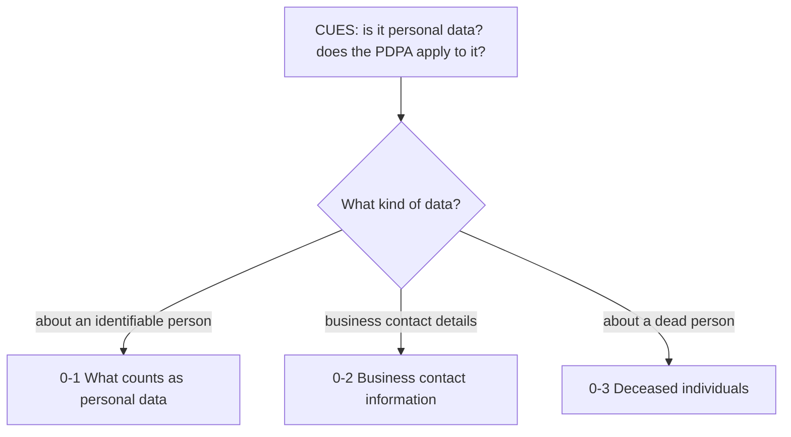

**Who is bound**

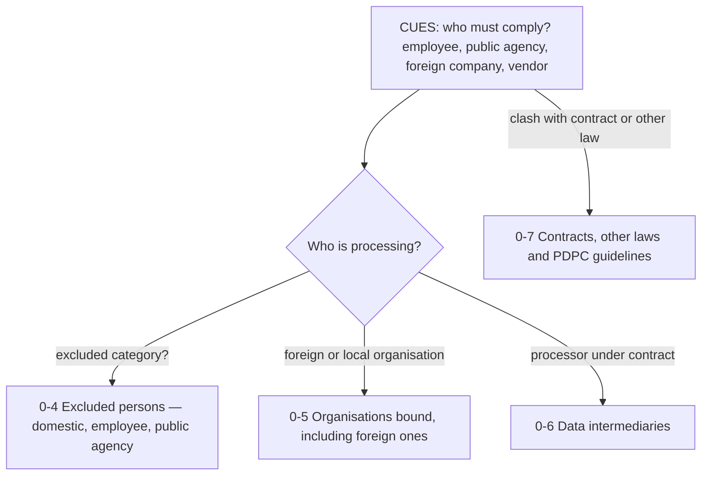

### clk-m-0-1 — What counts as personal data
*Keywords: personal data, identifiable individual, true or not, opinion, PDPA s 2(1)*

**End point:** Personal data is data, whether true or not, about an individual who can be identified from that data alone or with other information the organisation has or is likely to have access to; it covers facts and opinions.

*Source note: PDPA p11 (s 2(1)); DP-1 p17; SampleQs p89 Q1, key p130*

### clk-m-0-2 — Business contact information
*Keywords: business contact information, BCI, PDPA s 4(5)*

**End point:** Business contact information (name, title, business phone, address, email) not provided solely for personal purposes falls outside Parts 3 to 6A.

*Source note: PDPA p8 (s 2(1)), p14 (s 4(5))*

### clk-m-0-3 — Deceased individuals
*Keywords: deceased individual, 10 years, 100 years, PDPA s 4(4)*

**End point:** For a person dead 10 years or less, only the disclosure provisions and s 24 (protection) apply; dead more than 10 years, the Act does not apply; records 100 years or older are out of scope.

*Source note: PDPA p10 (s 2(1) individual), p14 (s 4(4))*

### clk-m-0-4 — Excluded persons — domestic, employee, public agency
*Keywords: personal or domestic capacity, employee, course of employment, public agency, Reed v Bellingham, PDPA s 4(1)*

**End point:** Parts 3 to 6B impose no obligation on an individual acting in a personal or domestic capacity, an employee acting in the course of employment, or a public agency; an employee relying on the exclusion must prove both limbs (Reed).

*Source note: PDPA p13 (s 4(1)); Reed p21*

### clk-m-0-5 — Organisations bound, including foreign ones
*Keywords: organisation, foreign company, partnership, unincorporated association, PDPA s 2(1)*

**End point:** An "organisation" is any individual, company, association or body of persons, whether or not formed or resident in Singapore, so foreign companies and unincorporated associations are bound.

*Source note: PDPA p11 (s 2(1)); SampleQs p91 Q7, key p130*

### clk-m-0-6 — Data intermediaries
*Keywords: data intermediary, processing on behalf, written contract, data controller, PDPA s 4(2), s 4(3)*

**End point:** A data intermediary processing for another organisation under a written contract owes only ss 24, 25, 26C(3)(a) and 26E; the controller has the same obligations as if it processed the data itself.

*Source note: PDPA p13 (s 4(2)-(3)); DP-1 p18. Conflict: DP-1 p18 also lists Part 6B; PDPA s 4(2) excludes it, and the statute is followed.*

### clk-m-0-7 — Contracts, other laws and PDPC guidelines
*Keywords: contractual obligation, other written law, inconsistency, advisory guidelines, PDPA s 4(6), s 49*

**End point:** A contractual obligation is no excuse for breaching the PDPA; other written law prevails where inconsistent; PDPC advisory guidelines are not binding.

*Source note: PDPA p14 (s 4(6)), p78 (s 49); DP-1 p13*

## 0.II Consent and legal bases

**Consent**

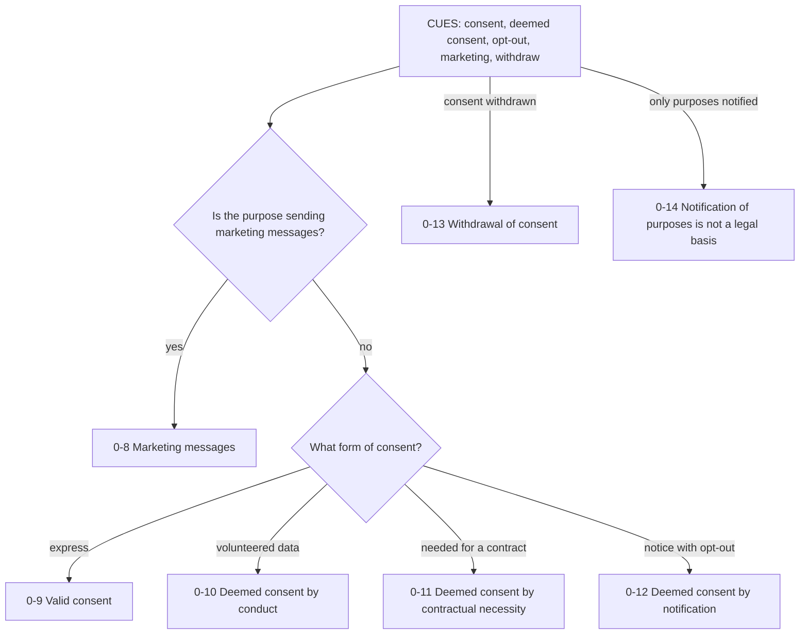

**No consent — exceptions**

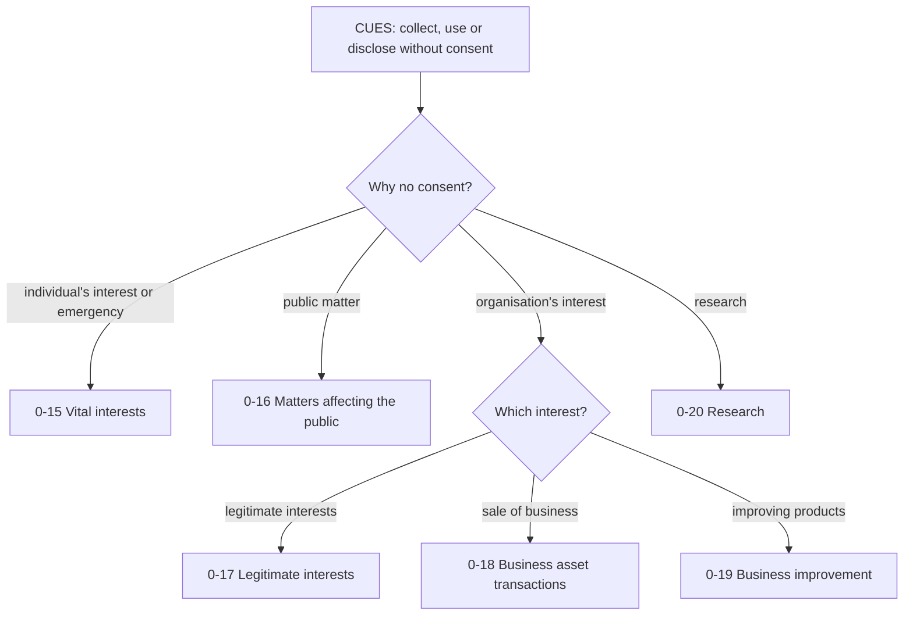

### clk-m-0-8 — Marketing messages
*Keywords: marketing, direct marketing, legitimate interests, business improvement, deemed consent by notification, PDPR reg 13*

**End point:** Legitimate interests, business improvement and deemed consent by notification cannot be used to send marketing messages, so consent (or another basis) is needed; it is false that marketing never needs consent.

*Source note: PDPA p98 (First Sch Pt 3 para 1(4)), p103-105 (Pt 5); PDPR p15 (reg 13); SampleQs p90 Q5, key p130*

### clk-m-0-9 — Valid consent
*Keywords: consent, validity, false or misleading, beyond reasonable, PDPA s 13, s 14*

**End point:** Consent is valid only if the s 20 purposes were notified first; it is invalid if required beyond what is reasonable to supply the product or service or obtained by deceptive practices, and may be given by an authorised person.

*Source note: PDPA p20-21 (ss 13-14)*

### clk-m-0-10 — Deemed consent by conduct
*Keywords: deemed consent, conduct, voluntarily provides, onward disclosure, PDPA s 15(1), s 15(2)*

**End point:** Consent is deemed where an individual voluntarily provides data for a purpose and it is reasonable that they would; it extends to onward disclosure for that purpose.

*Source note: PDPA p21 (s 15(1)-(2))*

### clk-m-0-11 — Deemed consent by contractual necessity
*Keywords: deemed consent, contractual necessity, conclusion of contract, performance of contract, PDPA s 15(3)-(8)*

**End point:** Data given with a view to a contract is deemed consented to for disclosure and use reasonably necessary to conclude or perform it, including onward to third parties.

*Source note: PDPA p21-23 (s 15(3)-(8))*

### clk-m-0-12 — Deemed consent by notification
*Keywords: deemed consent by notification, opt-out, adverse effect assessment, PDPA s 15A, PDPR reg 14*

**End point:** Before relying on it, the organisation must assess that there is no likely adverse effect, notify the individual of the purpose with a reasonable opt-out period, and keep the assessment; not available for marketing messages.

*Source note: PDPA p24-25 (s 15A); PDPR p15-16 (regs 13-14)*

### clk-m-0-13 — Withdrawal of consent
*Keywords: withdraw consent, reasonable notice, consequences, PDPA s 16*

**End point:** An individual may withdraw consent on reasonable notice; the organisation must explain the likely consequences, cannot prohibit withdrawal, and must stop (and make its intermediaries and agents stop) unless the law requires otherwise.

*Source note: PDPA p25-26 (s 16)*

### clk-m-0-14 — Notification of purposes is not a legal basis
*Keywords: notification of purposes, legal basis, PDPA s 20*

**End point:** Notifying purposes is a separate obligation, not a legal basis for collection, use or disclosure.

*Source note: SampleQs p92 Q8, key p130; DP-1 p26*

### clk-m-0-15 — Vital interests
*Keywords: vital interests, emergency, next of kin, clearly in the individual's interests, First Schedule Part 1*

**End point:** No consent is needed where processing is clearly in the individual's interests and consent cannot be obtained in time or would not reasonably be withheld (notify as soon as practicable), in emergencies threatening life or health, or to contact next of kin.

*Source note: PDPA p95-96 (First Sch Pt 1)*

### clk-m-0-16 — Matters affecting the public
*Keywords: publicly available, national interest, news activity, artistic, archival, historical, First Schedule Part 2*

**End point:** Publicly available data, the national interest, solely artistic or literary purposes, archival or historical purposes (unless too sensitive) and news activity by a news organisation are exceptions.

*Source note: PDPA p96-97 (First Sch Pt 2)*

### clk-m-0-17 — Legitimate interests
*Keywords: legitimate interests, assessment, adverse effect, investigation, debt recovery, legal services, employment, First Schedule Part 3*

**End point:** The organisation's legitimate interests must outweigh any adverse effect, after a prior assessment with mitigation, and the individual must have reasonable access to information about it; Part 3 also covers investigations, debt recovery, legal services and employment.

*Source note: PDPA p98-100 (First Sch Pt 3); PDPR p16-17 (reg 15)*

### clk-m-0-18 — Business asset transactions
*Keywords: business asset transaction, merger, acquisition, First Schedule Part 4*

**End point:** Data may be processed without consent in a business asset transaction, subject to conditions such as limiting it to necessary data and destroying or returning it if the deal fails.

*Source note: PDPA p100-102 (First Sch Pt 4)*

### clk-m-0-19 — Business improvement
*Keywords: business improvement, related corporation, personalise, First Schedule Part 5, Second Schedule Part 2 Division 2*

**End point:** Data may be used, or shared within related corporations, without consent to improve goods, services or methods, or to understand or personalise for customers, if identifiable form is needed and a reasonable person would find it appropriate; not for marketing.

*Source note: PDPA p103-105 (First Sch Pt 5), p106 (Second Sch Pt 2 Div 2)*

### clk-m-0-20 — Research
*Keywords: research, public benefit, impracticable to seek consent, Second Schedule*

**End point:** Use for research needs identifiable form to be necessary, a clear public benefit, no decisions about the individual, and no identification in published results; disclosure for research also needs consent to be impracticable.

*Source note: PDPA p106-108 (Second Sch)*

## 0.III Other organisational obligations

**Governance and collection**

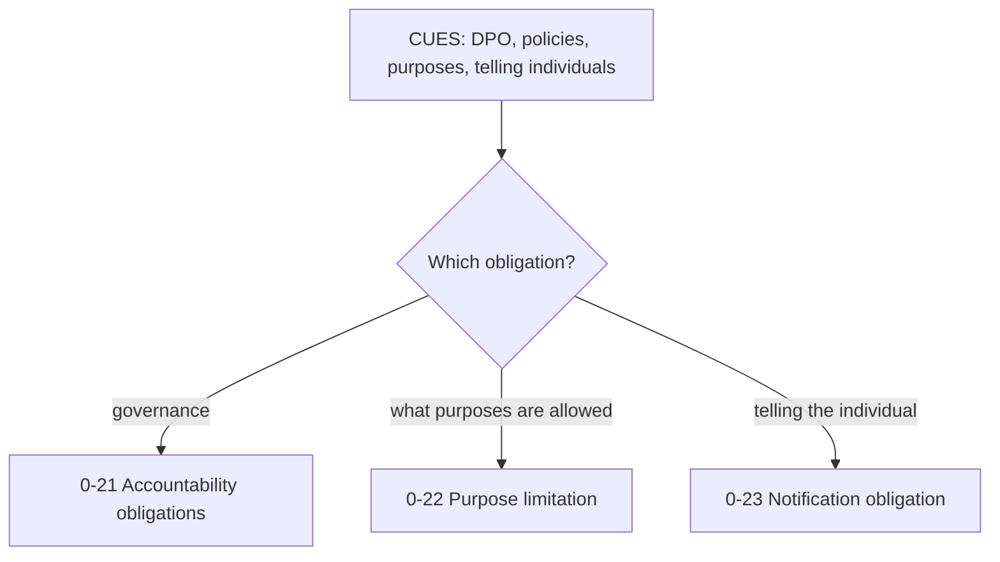

**Holding and sending data**

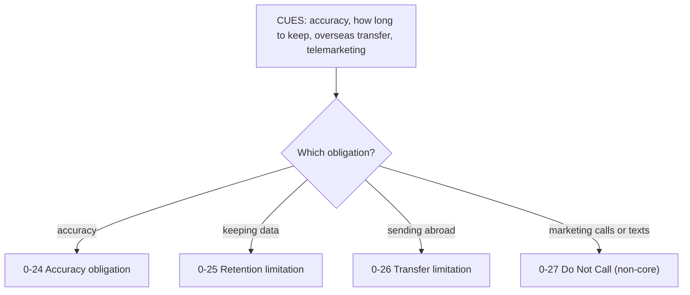

### clk-m-0-21 — Accountability obligations
*Keywords: accountability, data protection officer, DPO, policies and practices, complaints process, data inventory, DPIA, PDPA s 11, s 12*

**End point:** An organisation must designate a DPO and publish their business contact details, develop and communicate policies and practices, set up a complaints process, and make information available on request; a data inventory or DPIA is not an express requirement.

*Source note: PDPA p19-20 (ss 11-12); SampleQs p90 Q4, key p130; DP-1 p28 (lists a data inventory only as a measure that may be taken)*

### clk-m-0-22 — Purpose limitation
*Keywords: purpose limitation, reasonable person, appropriate, PDPA s 18*

**End point:** Data may be collected, used or disclosed only for purposes a reasonable person would consider appropriate in the circumstances and that the individual has been informed of.

*Source note: PDPA p27 (s 18); DP-1 p26*

### clk-m-0-23 — Notification obligation
*Keywords: notification, purposes, before collection, new purpose, PDPA s 20*

**End point:** The organisation must tell the individual its purposes on or before collection and before any new use, and give a contact on request; this is not needed for deemed consent or s 17 exceptions, but is still needed for employment purposes.

*Source note: PDPA p27-29 (s 20)*

### clk-m-0-24 — Accuracy obligation
*Keywords: accuracy, complete, decision affecting the individual, PDPA s 23*

**End point:** Reasonable effort to ensure accuracy and completeness is required only if the data is likely to be used to make a decision affecting the individual or disclosed to another organisation.

*Source note: PDPA p32-33 (s 23)*

### clk-m-0-25 — Retention limitation
*Keywords: retention, cease to retain, anonymise, legal or business purposes, PDPA s 25*

**End point:** An organisation must stop retaining data, or anonymise it, once both the purpose is no longer served and retention is no longer necessary for legal or business purposes.

*Source note: PDPA p33 (s 25)*

### clk-m-0-26 — Transfer limitation
*Keywords: transfer limitation, overseas transfer, comparable standard, contract, binding corporate rules, APEC CBPR, PDPA s 26, PDPR reg 10*

**End point:** Data may go overseas only if the recipient is bound by legally enforceable obligations of a comparable standard (law, contract, binding corporate rules, CBPR or PRP certification), or on valid consent, contractual necessity or in transit.

*Source note: PDPA p33-34 (s 26); PDPR p10-14 (Part 3, regs 10-12). Conflict: Cyril-Exam DP §1.2.2 cites "s 10 PDPR"; it is reg 10.*

### clk-m-0-27 — Do Not Call (non-core)
*Keywords: Do Not Call, DNC register, specified message, calling line identity, PDPA s 43, s 44, s 45*

**End point:** Before sending specified marketing messages the sender must check the DNC register (s 43), identify itself with contact details valid for 30 days (s 44), and not conceal its calling line identity (s 45); Part 9 is outside the core reading list.

*Source note: DP-1 p28; PDPA p44-47 (ss 43-45); DP-Plan p5*

## 0.IV Individual rights and private action

**Requests**

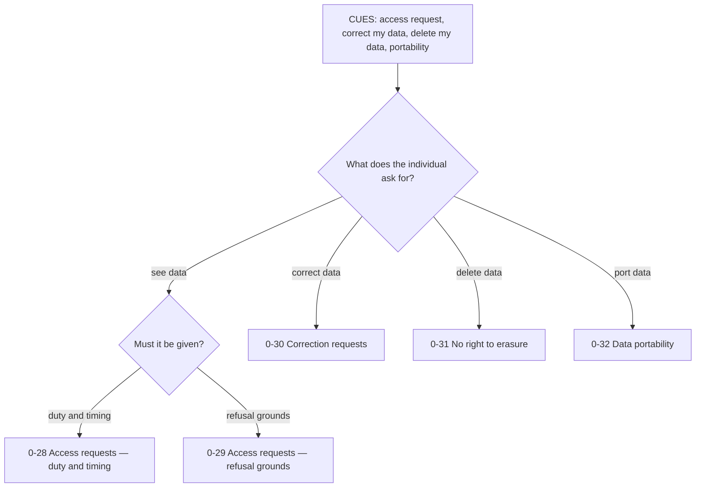

**Suing**

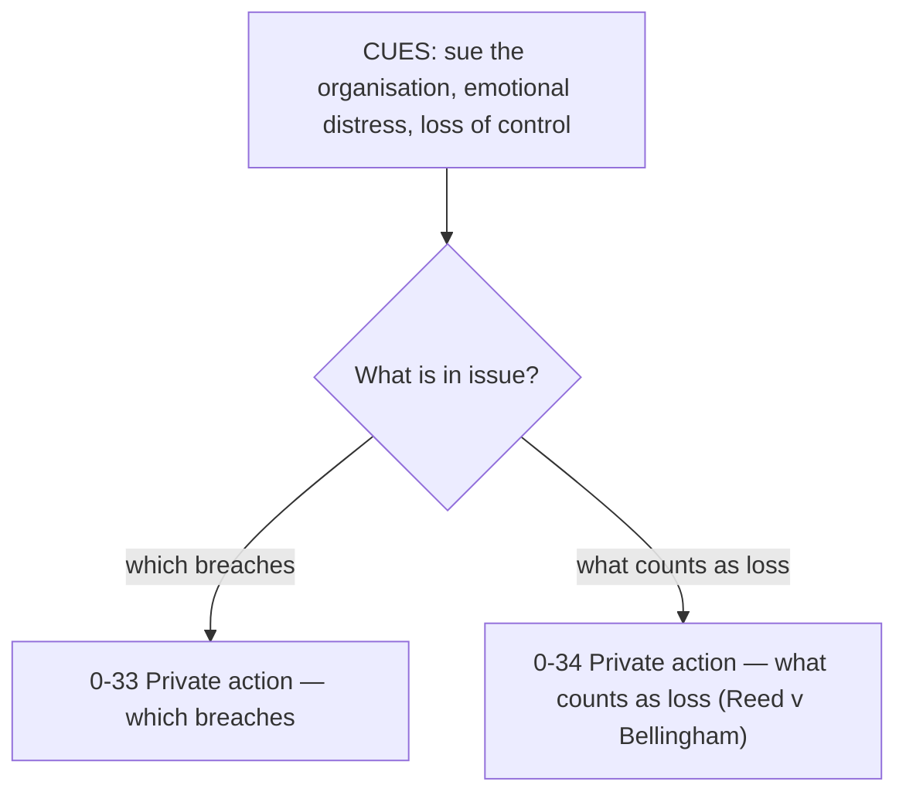

### clk-m-0-28 — Access requests — duty and timing
*Keywords: access request, past year, 30 days, fee, written estimate, PDPA s 21, PDPR reg 5, reg 7*

**End point:** On request the organisation must provide the data and how it was used or disclosed in the past year as soon as reasonably possible; if it cannot respond within 30 days it must say in writing when it will, and it may charge a reasonable fee after a written estimate.

*Source note: PDPA p29-31 (s 21); PDPR p5 (reg 5), p6-8 (reg 7)*

### clk-m-0-29 — Access requests — refusal grounds
*Keywords: Fifth Schedule, opinion data, examination, privileged, confidential commercial information, safety, another individual, PDPA s 21(3), s 21(4), s 22A*

**End point:** Fifth Schedule items (e.g. evaluative opinions, exam scripts, privileged material, confidential commercial information) need not be provided; data must not be provided if it threatens safety or health, causes grave harm, reveals another individual's data or harms the national interest; keep a copy after refusing.

*Source note: PDPA p29-30 (s 21(3)-(4)), p32 (s 22A), p108-109 (Fifth Sch)*

### clk-m-0-30 — Correction requests
*Keywords: correction, error or omission, annotate, opinion, no fee, PDPA s 22*

**End point:** The organisation must correct an error or omission and send the correction to organisations it disclosed to in the past year, or annotate the data if it decides not to; opinions need not be altered, and no fee may be charged.

*Source note: PDPA p31-32 (s 22), p109-110 (Sixth Sch); PDPR p6-8 (reg 7)*

### clk-m-0-31 — No right to erasure
*Keywords: erasure, deletion, right to be forgotten, withdraw consent, retention*

**End point:** The PDPA gives no right to deletion; the individual can withdraw consent (s 16) and the organisation must stop retaining data under s 25.

*Source note: DP-1 p31-32; SampleQs p92 Q9, key p130. Conflict: Cyril-Exam DP §1.3 and Nic-DP p4 list a right to erasure; the module and official key say there is none.*

### clk-m-0-32 — Data portability
*Keywords: data portability, porting, not in force*

**End point:** Data portability is legislated but not yet in force.

*Source note: DP-1 p32*

### clk-m-0-33 — Private action — which breaches
*Keywords: private action, right of action, Part 4, Part 5, Part 6, Part 6A, Part 6B, injunction, damages, PDPA s 48O*

**End point:** A person who suffers loss or damage directly from a breach of Parts 4, 5, 6, 6A or 6B (not Part 3) or the Do Not Call provisions may sue for an injunction, declaration or damages, but only once any PDPC decision on it is final.

*Source note: PDPA p73-74 (s 48O)*

### clk-m-0-34 — Private action — what counts as loss (Reed v Bellingham)
*Keywords: Reed v Bellingham, emotional distress, loss of control, loss or damage*

**End point:** Emotional distress is "loss or damage" under s 48O, but mere loss of control over personal data is not.

*Source note: Reed p47-48 ([107]-[108])*

## 0.V PDPC enforcement and offences

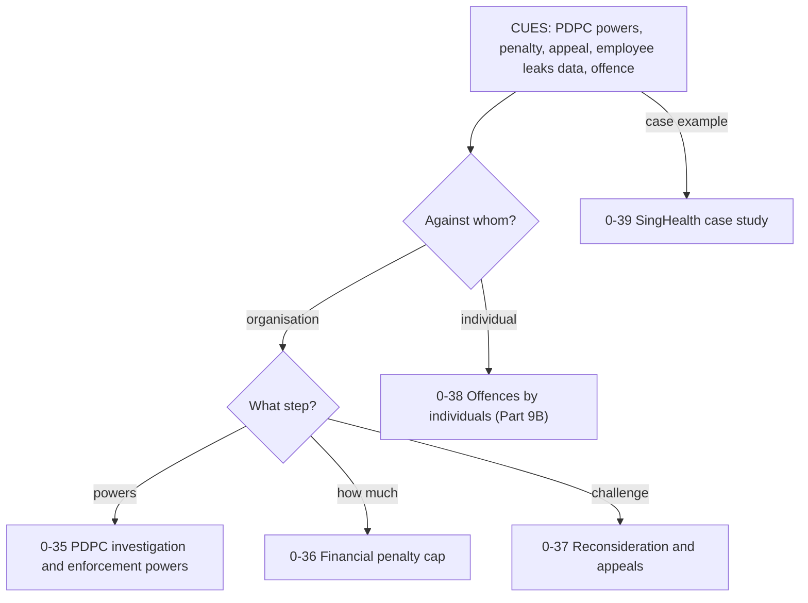

### clk-m-0-35 — PDPC investigation and enforcement powers
*Keywords: PDPC, investigation, mediation, directions, voluntary undertaking, PDPA s 50, s 48G, s 48H, s 48I, s 48L*

**End point:** The PDPC investigates under s 50 (and may suspend or discontinue it, e.g. on settlement or an accepted undertaking) and may refer to mediation, review access or correction responses, issue directions, impose penalties and accept voluntary undertakings.

*Source note: PDPA p61-70 (ss 48G-48L), p77 (s 50); DP-1 p35*

### clk-m-0-36 — Financial penalty cap
*Keywords: financial penalty, 10% of turnover, $1 million, intentional or negligent, PDPA s 48J*

**End point:** The maximum is 10% of annual Singapore turnover if turnover exceeds $10 million, otherwise $1 million, and only for intentional or negligent breaches that are not themselves offences.

*Source note: PDPA p64-65 (s 48J(3)); DP-1 p35. Conflict: DP-1 p35 and Cyril-Exam DP §1.4 say "10% or $1 million, whichever is higher"; same result, statute wording followed.*

### clk-m-0-37 — Reconsideration and appeals
*Keywords: reconsideration, Data Protection Appeal Panel, Appeal Committee, High Court, PDPA s 48N, s 48Q, s 48R*

**End point:** A PDPC decision may be reconsidered (s 48N), then appealed to the Data Protection Appeal Panel (s 48Q) and on to the High Court (s 48R).

*Source note: PDPA p71-75 (ss 48N-48R)*

### clk-m-0-38 — Offences by individuals (Part 9B)
*Keywords: unauthorised disclosure, improper use, re-identification, anonymised, $5,000, 2 years, PDPA s 48D, s 48E, s 48F*

**End point:** An individual commits an offence by knowing or reckless unauthorised disclosure (s 48D), improper use for gain or to cause harm or loss (s 48E), or unauthorised re-identification of anonymised data (s 48F); fine up to $5,000 and/or up to 2 years, with defences including prior public availability, legal permission and consent.

*Source note: PDPA p54-61 (ss 48C-48F); PDPR p17 (regs 15A-15B)*

### clk-m-0-39 — SingHealth case study
*Keywords: SingHealth, IHiS, cyber attack, $250,000, $750,000, data intermediary*

**End point:** SingHealth was fined $250,000 and its data intermediary IHiS $750,000 after 1.5 million patients' data was taken; the controller's protection duty is not delegated away by using an intermediary.

*Source note: SingH p7, p49; Nic-DP p7-8*

## 0.VI Protection obligation and data breach notification

**Security duty and notifiability**

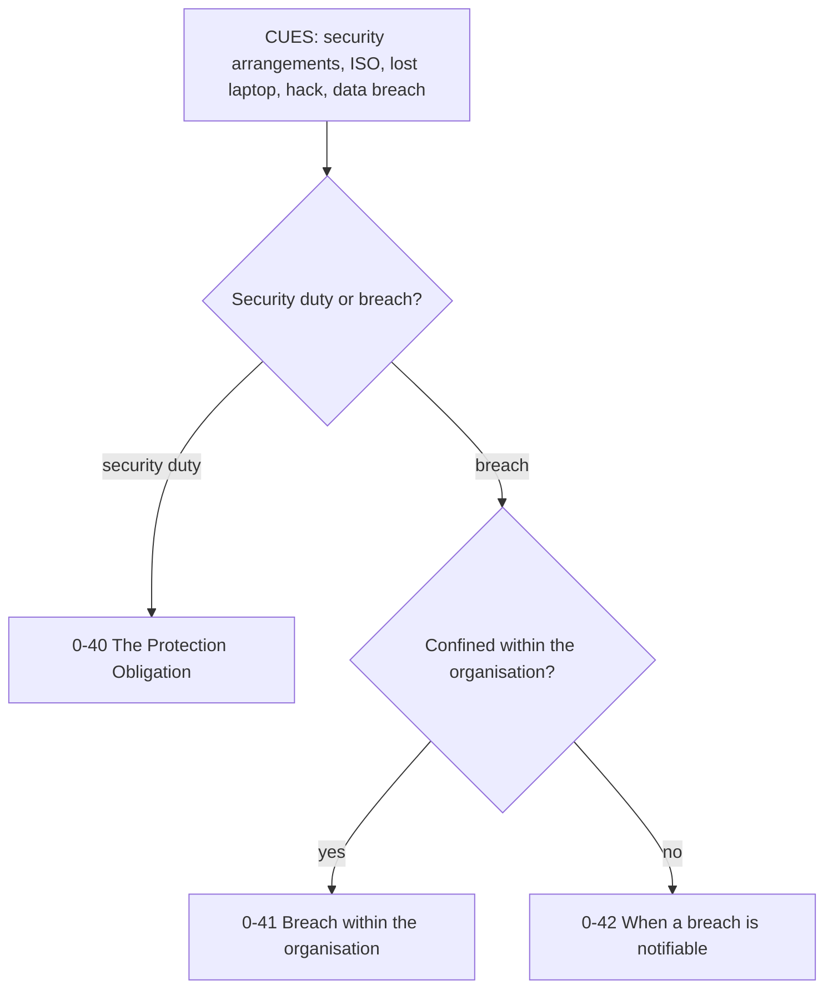

**After a notifiable breach**

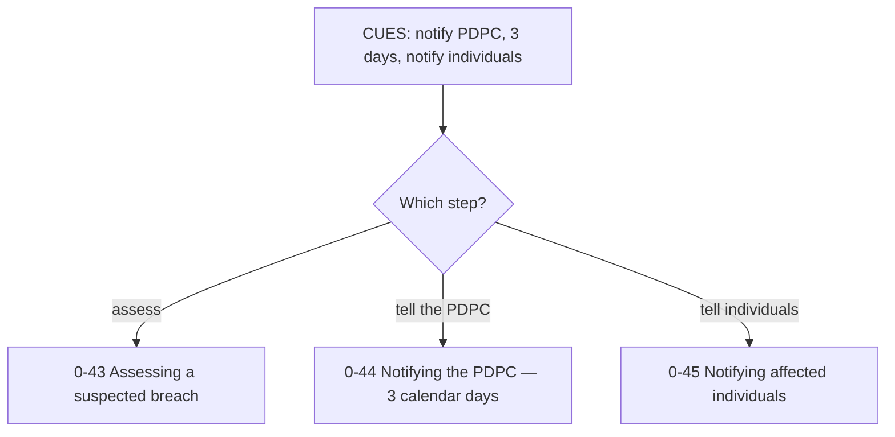

### clk-m-0-40 — The Protection Obligation
*Keywords: protection obligation, reasonable security arrangements, storage medium, ISO 27001, administrative, technical, physical, PDPA s 24*

**End point:** An organisation (controller or intermediary) must make reasonable security arrangements against unauthorised access, collection, use, disclosure, copying, modification or disposal, and loss of storage media; there is no one-size-fits-all and no mandated standard such as ISO 27001.

*Source note: PDPA p33 (s 24); DP-2 p40-44; SampleQs p91-92 Q6, Q10, key p130*

### clk-m-0-41 — Breach within the organisation
*Keywords: data breach, within an organisation, not notifiable, PDPA s 26B(4)*

**End point:** A breach that relates only to unauthorised access within the organisation is deemed not notifiable.

*Source note: PDPA p35 (s 26B(4))*

### clk-m-0-42 — When a breach is notifiable
*Keywords: notifiable data breach, significant harm, significant scale, 500 individuals, account identifier, password, PDPA s 26B, DBNR reg 3, reg 4*

**End point:** A breach is notifiable if it causes or is likely to cause significant harm, or affects 500 or more individuals; harm is deemed for a name or ID number plus prescribed data, or an account identifier plus password.

*Source note: PDPA p34-35 (s 26B); DBNR p2 (regs 3-4). Conflict: Cyril-Exam DP §2.1.2 lists name, account identifier and credentials separately; DBNR reg 3 requires the combinations.*

### clk-m-0-43 — Assessing a suspected breach
*Keywords: assessment, reasonable and expeditious, 30 days, data intermediary, without undue delay, PDPA s 26C*

**End point:** The organisation must assess a suspected breach reasonably and expeditiously (PDPC guidance: generally within 30 days, not in the statute); a data intermediary must tell the controller without undue delay.

*Source note: PDPA p35-36 (s 26C); KC p130*

### clk-m-0-44 — Notifying the PDPC — 3 calendar days
*Keywords: notify PDPC, 3 calendar days, after assessment, late notification, PDPA s 26D(1), DBNR reg 5*

**End point:** The PDPC must be notified as soon as practicable and no later than 3 calendar days after the day the organisation assesses the breach as notifiable (not from discovery); late notices must give reasons.

*Source note: PDPA p36 (s 26D(1)); DBNR p3-4 (reg 5)*

### clk-m-0-45 — Notifying affected individuals
*Keywords: notify individuals, on or after, scale-only, remedial action, waiver, law enforcement, PDPA s 26D(2), s 26D(5)-(7)*

**End point:** Individuals must be notified on or after notifying the PDPC, and only for harm-type breaches (not scale-only ones), unless remedial action or prior technological protection makes harm unlikely, the PDPC or a law-enforcement agency directs otherwise, or the PDPC waives it.

*Source note: PDPA p36-37 (s 26D(2), (5)-(7)); DP-2 p49-50. Conflict: Nic-DP p6 says "concurrently"; the Act says on or after.*

## 0.VII Cybersecurity Act — critical information infrastructure

**Is it CII?**

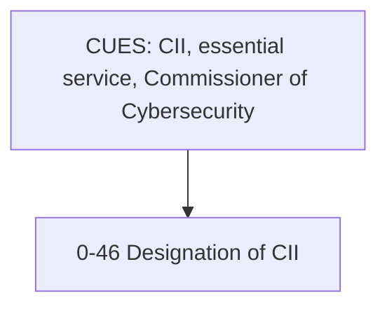

**Owner duties**

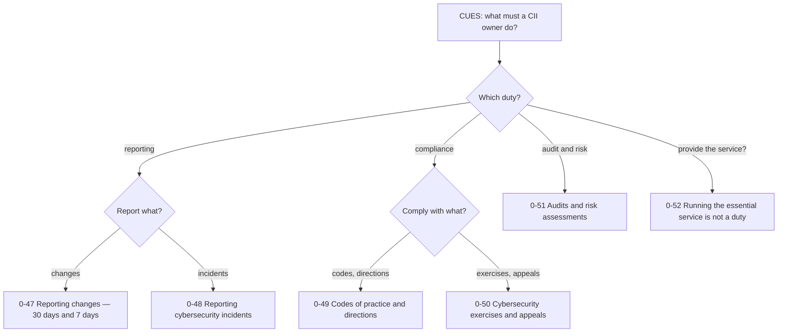

**Governance and incident powers**

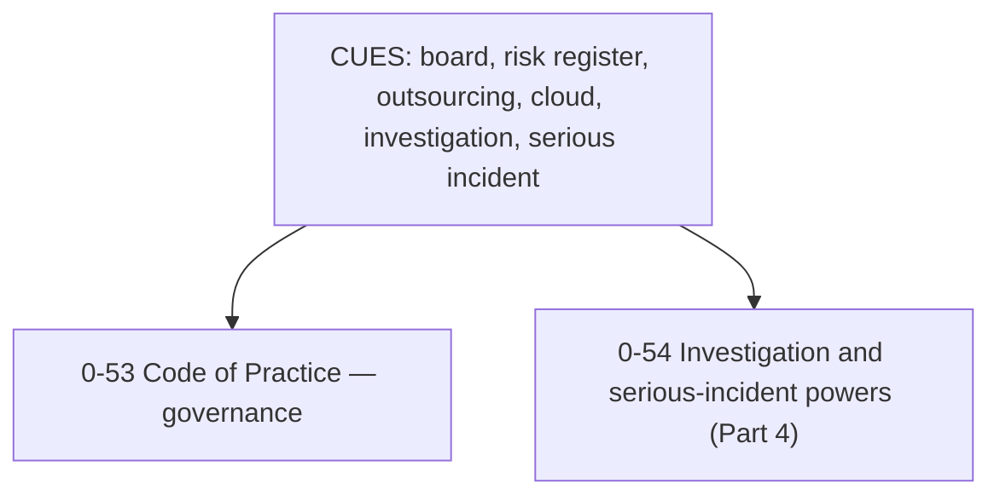

### clk-m-0-46 — Designation of CII
*Keywords: critical information infrastructure, CII, designation, essential service, 5 years, Cybersecurity Act s 7, First Schedule*

**End point:** A computer system is designated CII if it is necessary for the continuous delivery of an essential service whose loss would be debilitating, and is located wholly or partly in Singapore; designation lasts 5 years, and ownership or place of incorporation is not a criterion.

*Source note: CYSA p13-15 (s 7), p69-71 (First Sch); DP-2 p18-21. Conflict: DP-2 p20 says "located in Singapore"; the Act says wholly or partly.*

### clk-m-0-47 — Reporting changes — 30 days and 7 days
*Keywords: material change, change in ownership, 30 days, 7 days, Cybersecurity Act s 10, s 13*

**End point:** A CII owner must furnish information on request and report material changes within 30 days (s 10), and report a change in beneficial or legal ownership within 7 days (s 13).

*Source note: CYSA p17-18 (s 10), p20 (s 13)*

### clk-m-0-48 — Reporting cybersecurity incidents
*Keywords: cybersecurity incident, prescribed incident, detection mechanisms, Cybersecurity Act s 14*

**End point:** The owner must report prescribed cybersecurity incidents (and any others the Commissioner specifies) within the prescribed period and keep mechanisms to detect them.

*Source note: CYSA p20-21 (s 14); DP-2 p25*

### clk-m-0-49 — Codes of practice and directions
*Keywords: code of practice, standards of performance, no legislative effect, waiver, directions, Cybersecurity Act s 11, s 12*

**End point:** Codes of practice have no legislative effect, but CII owners must comply unless the Commissioner waives it; owners must also comply with written directions.

*Source note: CYSA p19-20 (ss 11-12); DP-2 p24*

### clk-m-0-50 — Cybersecurity exercises and appeals
*Keywords: cybersecurity exercise, appeal to Minister, Cybersecurity Act s 16, s 17*

**End point:** A CII owner must take part in a cybersecurity exercise when directed (s 16), and may appeal designations and directions to the Minister (s 17).

*Source note: CYSA p24-25 (ss 16-17). Conflict: DP-2 p27 and Cyril-Exam DP §2.2.1 cite s 15(7)-(8) for the exercise offence; it is s 16(3).*

### clk-m-0-51 — Audits and risk assessments
*Keywords: audit, risk assessment, once every 2 years, once a year, 30 days, Cybersecurity Act s 15*

**End point:** A CII owner must have an audit at least once every 2 years and a risk assessment at least once a year, and give the reports to the Commissioner within 30 days of completion.

*Source note: CYSA p22 (s 15); DP-2 p26*

### clk-m-0-52 — Running the essential service is not a duty
*Keywords: essential service, not an obligation, CII owner*

**End point:** Providing the essential service using the CII is not one of a CII owner's obligations under the Act.

*Source note: SampleQs p89 Q2, key p130*

### clk-m-0-53 — Code of Practice — governance
*Keywords: Cybersecurity Code of Practice, governance, board, risk register, 12 months, cloud, outsourcing*

**End point:** The board and senior management must include a member with cybersecurity knowledge; there must be a risk framework and a risk register for each CII, policies reviewed every 12 months, and the owner stays responsible when outsourcing or using the cloud.

*Source note: CoP p17-24 (section 3); DP-2 p35-36*

### clk-m-0-54 — Investigation and serious-incident powers (Part 4)
*Keywords: investigation powers, serious cybersecurity incident, severity threshold, privilege, Cybersecurity Act s 19, s 20*

**End point:** Under s 19 the Commissioner may require anyone to attend, answer and produce records (privilege respected, contracts no excuse); for serious incidents meeting the severity threshold, s 20 adds remedial directions, entry, scanning and seizure.

*Source note: CYSA p28-34 (ss 19-20); DP-2 p29-31*

## 0.VIII POHA — offences and civil remedies

**Offences**

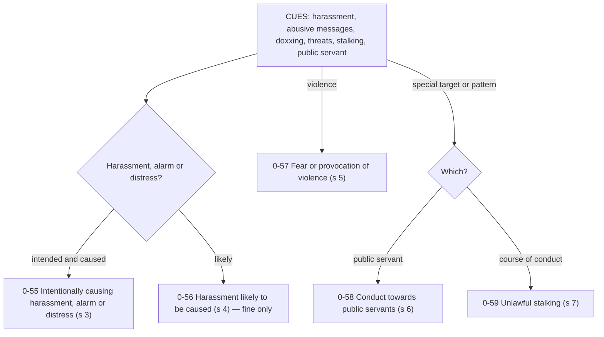

**Civil remedies**

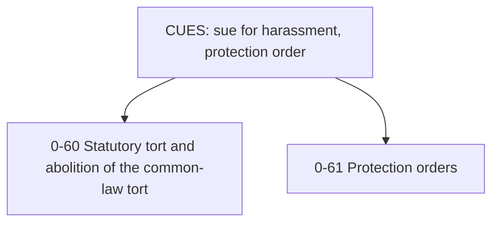

### clk-m-0-55 — Intentionally causing harassment, alarm or distress (s 3)
*Keywords: intentional harassment, doxxing, identity information, POHA s 3*

**End point:** Intending to cause harassment, alarm or distress by threatening, abusive or insulting words or behaviour, or by publishing identity information, and causing it, is punishable by a fine up to $5,000 and/or up to 6 months.

*Source note: POHA p8-9 (s 3); DP-3 p8-9*

### clk-m-0-56 — Harassment likely to be caused (s 4) — fine only
*Keywords: harassment, likely to cause, fine only, entity, POHA s 4*

**End point:** Threatening, abusive or insulting conduct likely to cause harassment, alarm or distress to a person who perceives it is punishable by a fine up to $5,000 only; it binds individuals and entities.

*Source note: POHA p10 (s 4); DP-3 p10. Conflict: Cyril-Exam DP §3.2.2 and Nic-DP p11 add up to 6 months' imprisonment; the Act provides a fine only.*

### clk-m-0-57 — Fear or provocation of violence (s 5)
*Keywords: fear of violence, provocation, POHA s 5*

**End point:** Causing fear of, or provoking or facilitating, unlawful violence is punishable by a fine up to $5,000 and/or up to 12 months; the "no reason to believe it would be seen" defence applies only to s 5(1)(b).

*Source note: POHA p11-12 (s 5). Conflict: Cyril-Exam DP §3.2.3 applies that defence to all of s 5.*

### clk-m-0-58 — Conduct towards public servants (s 6)
*Keywords: public servant, public service worker, POHA s 6*

**End point:** Threatening, abusive or insulting conduct towards a public servant or public service worker in relation to their duties, where the accused knew or ought to have known their capacity, is punishable by a fine up to $5,000 and/or up to 12 months.

*Source note: POHA p13 (s 6)*

### clk-m-0-59 — Unlawful stalking (s 7)
*Keywords: unlawful stalking, course of conduct, POHA s 7*

**End point:** A course of conduct amounting to stalking that causes harassment, alarm or distress is punishable by a fine up to $5,000 and/or up to 12 months; reasonable conduct is a defence.

*Source note: POHA p15-17 (s 7); DP-Plan p5. Conflict: Cyril-Exam DP omits s 7; it is core.*

### clk-m-0-60 — Statutory tort and abolition of the common-law tort
*Keywords: statutory tort, damages, common-law tort of harassment abolished, POHA s 11, s 14*

**End point:** A victim of ss 3, 4, 5 or 7 may sue for damages under the s 11 statutory tort; the common-law tort of harassment is abolished (s 14).

*Source note: POHA p23 (s 11), p36 (s 14); DP-3 p16*

### clk-m-0-61 — Protection orders
*Keywords: protection order, likely to continue, just and equitable, Exempt Class of Persons Order, POHA s 12*

**End point:** The court may grant a protection order if satisfied of a contravention of ss 3 to 7, that it is likely to continue or be repeated, and that an order is just and equitable (deemed on conviction or voluntarily causing hurt); none lies against passive network or search providers (non-core Order).

*Source note: POHA p24-26 (s 12); DP-3 p17, p24*

## 0.IX False statements — POHA orders and POFMA

**Which order?**

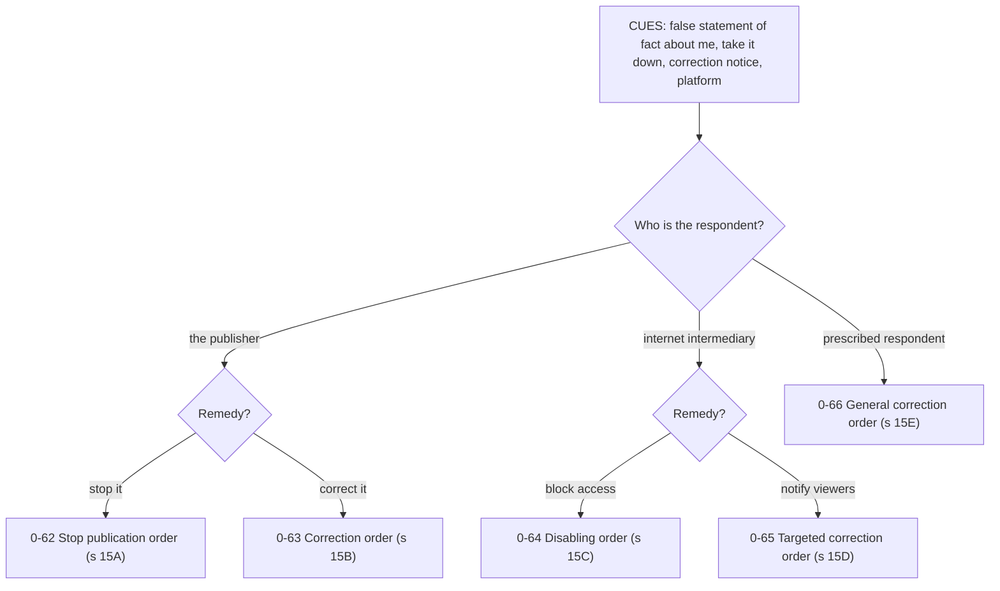

**Requirements and POFMA**

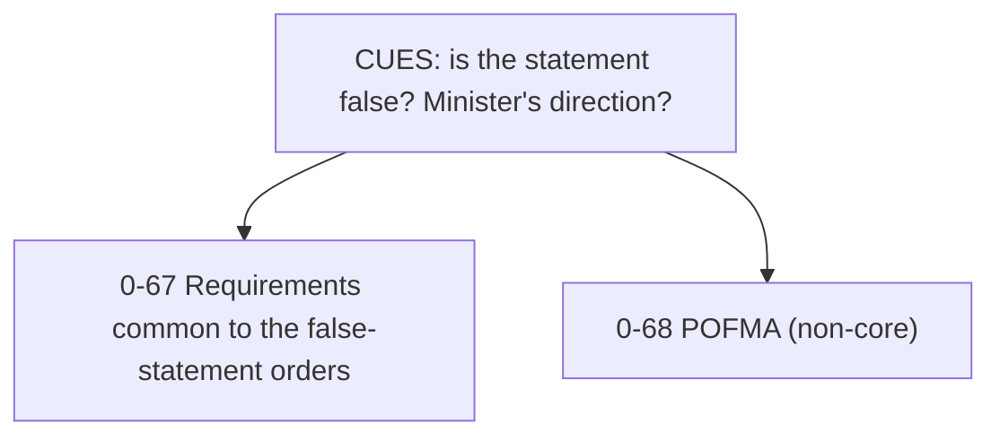

### clk-m-0-62 — Stop publication order (s 15A)
*Keywords: stop publication order, publisher, POHA s 15A*

**End point:** The court may order the publisher (an individual or entity) to stop publishing the false statement and any substantially similar statement; "publishing" excludes intermediary, telco and access services.

*Source note: POHA p38-40 (s 15A); DP-3 p19-20*

### clk-m-0-63 — Correction order (s 15B)
*Keywords: correction order, correction notice, POHA s 15B*

**End point:** The court may order the publisher to publish a correction notice.

*Source note: POHA p39 (s 15B); DP-3 p21. Conflict: DP-3 p21 and Cyril-Exam DP §4.1.2 label it "(SPO)"; the statute name is correction order.*

### clk-m-0-64 — Disabling order (s 15C)
*Keywords: disabling order, internet intermediary, end-users in Singapore, POHA s 15C*

**End point:** The court may order an internet intermediary to disable access by end-users in Singapore to the false statement (and identical copies, for prescribed intermediaries).

*Source note: POHA p40-41 (s 15C); DP-3 p22. Conflict: DP-3 p22 labels it "correction order (DO)"; the statute name is disabling order.*

### clk-m-0-65 — Targeted correction order (s 15D)
*Keywords: targeted correction order, internet intermediary, POHA s 15D*

**End point:** The court may order an internet intermediary to send a correction notice to end-users in Singapore who accessed the statement.

*Source note: POHA p41-42 (s 15D). Conflict: Cyril-Exam DP §4.1.4 calls it a "direction"; under POHA it is an order (directions are POFMA).*

### clk-m-0-66 — General correction order (s 15E)
*Keywords: general correction order, prescribed respondent, serious harm to reputation, newspaper, broadcaster, POHA s 15E*

**End point:** The court may order a prescribed respondent (newspaper, broadcaster, telco or intermediary) to publish a correction where the statement has caused or is likely to cause serious harm to the subject's reputation.

*Source note: POHA p42-43 (s 15E); POHA Regs p3 (reg 4(4)). Conflict: Cyril-Exam DP §4.1.5 lists WeChat and YouTube as prescribed for s 15E; reg 4(4) lists Facebook/Instagram, Twitter, HardwareZone, Google Search and Baidu.*

### clk-m-0-67 — Requirements common to the false-statement orders
*Keywords: false statement of fact, balance of probabilities, just and equitable, does not know it is false, specific correction order, POHA s 15*

**End point:** The applicant must show on a balance of probabilities a false statement of fact about them, published by the respondent, and that an order is just and equitable; the respondent need not know it is false, and orders may issue even if it was amended or taken down. There is no "specific correction order".

*Source note: POHA p37-38 (ss 15, 15A(2)); SampleQs p89 Q3, key p130*

### clk-m-0-68 — POFMA (non-core)
*Keywords: POFMA, ministerial direction, correction direction, stop communication direction, access blocking order, declared online location*

**End point:** POFMA works through ministerial directions (correction, stop communication, access blocking, directions to intermediaries) rather than court orders; s 7 makes it an offence to communicate a known falsehood likely to cause specified harms.

*Source note: DP-3 p27; POFMA p13-15; DP-Plan p6*

## 1.I What law and technology is

```mermaid
flowchart TD
  C["CUES: Law of the Horse, cyberlaw, what cyberlaw might teach, is law a technology"] --> W{"Whose view, or which question?"}
  W -- "framing question" --> L1["1-1 The Big Question"]
  W -- "Easterbrook" --> L2["1-2 Easterbrook — the Law of the Horse"]
  W -- "Lessig" --> L{"Which Lessig point?"}
  L -- "how behaviour is regulated" --> L3["1-3 Lessig — the four constraints"]
  L -- "why cyberspace is special" --> L4["1-4 Lessig — why cyberspace is special"]
  W -- "is law a technology?" --> L5["1-5 Is law a technology?"]
```

### clk-m-1-1 — The Big Question
*Keywords: Big Question, issue with the law, issue with the technology*

**End point:** Ask whether the problem lies with the law (fix the law), the technology (fix the technology), or both.

*Source note: LT-1 p16*

### clk-m-1-2 — Easterbrook — the Law of the Horse
*Keywords: Easterbrook, Law of the Horse, cyberlaw, unifying principles, Chicago School, property rights, bargaining*

**End point:** Grouping law around one technology is "doomed to be shallow and to miss unifying principles", so study general rules and keep doing what you have been doing; his prescriptions are clear rules, property rights and bargaining institutions.

*Source note: LT-1 p19-21; SampleQs p94 Q6, key p130*

### clk-m-1-3 — Lessig — the four constraints
*Keywords: Lessig, four modalities, law, norms, markets, architecture, code, direct regulation, indirect regulation*

**End point:** Behaviour is regulated by law, social norms, markets and architecture (code); law acts directly, or indirectly by changing the other three, and code is plastic, chosen by those who write it.

*Source note: LT-1 p23-24; LT-2 p6*

### clk-m-1-4 — Lessig — why cyberspace is special
*Keywords: Lessig, What Cyberlaw Might Teach, specialised study, constitutional values*

**End point:** Cyberspace is special enough that specialised study is useful and possible — because its architecture regulates behaviour, not merely because it is new — and law must regulate code to preserve constitutional values.

*Source note: LT-1 p25-26; SampleQs p95 Q7, key p130. Conflict: Cyril-Exam LT §1.2 and Nic-LT p2 say Lessig wanted "a new field of law"; the slide says only that specialised study is useful.*

### clk-m-1-5 — Is law a technology?
*Keywords: Elliot, Holmes, common law as artificial intelligence, cybernetic feedback*

**End point:** Elliot (1984) described Holmes's common law as a system of artificial intelligence learning by cybernetic feedback; whether law is a technology depends on how "law" and "technology" are defined.

*Source note: LT-1 p14-15. Conflict: Cyril-Exam LT §1.1 says Holmes himself called the common law AI; the slide quotes Elliot writing about Holmes.*

## 1.II Regulation theory

**The regulatory toolkit**

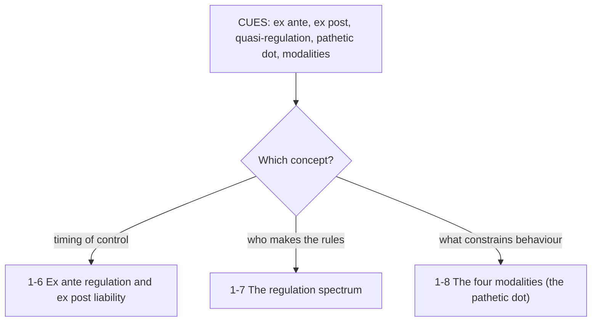

**Thinkers and dilemmas**

```mermaid
flowchart TD
  C["CUES: Bennett Moses, Yeong Zee Kin, Collingridge, law lags technology"] --> Q{"Which idea?"}
  Q -- "values and harm" --> L1["1-9 Bennett Moses"]
  Q -- "applied and supplied" --> L2["1-10 Yeong Zee Kin"]
  Q -- "too early or too late" --> L3["1-11 The Collingridge dilemma"]
  Q -- "law is too slow" --> L4["1-12 The legal tortoise and the technological hare"]
```

### clk-m-1-6 — Ex ante regulation and ex post liability
*Keywords: ex ante, ex post, regulation, liability, Shavell*

**End point:** Regulation controls conduct before harm (e.g. speed limits); liability responds after it (e.g. tort).

*Source note: LT-2 p3*

### clk-m-1-7 — The regulation spectrum
*Keywords: formal regulation, quasi-regulation, self-regulation, codes of practice, soft law, Moran*

**End point:** Rules run from formal regulation (legislation) through quasi-regulation (state-backed soft law such as codes of practice) to self-regulation by industry.

*Source note: LT-2 p3*

### clk-m-1-8 — The four modalities (the pathetic dot)
*Keywords: pathetic dot, four modalities, market, architecture, law, norms, regulations, car radio, choice architecture*

**End point:** The four modalities are market, architecture (including code), law (formal regulations, liability and property rules) and norms; "regulations" sit inside law and are not a fifth; the same constraint can be imposed through different modalities at different cost.

*Source note: LT-2 p6-8; SampleQs p94 Q5, key p130*

### clk-m-1-9 — Bennett Moses
*Keywords: Bennett Moses, technology regulation, socio-technical landscape, technology-neutral, risk-specific*

**End point:** The useful question is not "technology regulation" but how to protect values and minimise harm in an evolving socio-technical landscape; rules may be technology-specific, risk-specific or technology-neutral.

*Source note: LT-2 p10-12*

### clk-m-1-10 — Yeong Zee Kin
*Keywords: Yeong Zee Kin, misnomer, applied and supplied, laws ex post, regulations ex ante*

**End point:** "Technology regulation" is a misnomer: law regulates how technology is applied and supplied; laws are overarching and enforced after the event, regulations are role-specific and set standards in advance.

*Source note: LT-2 p13-14. Conflict: Cyril-Exam LT §2.2.2 attributes the laws/regulations distinction to Bennett Moses; the slide gives it to Yeong.*

### clk-m-1-11 — The Collingridge dilemma
*Keywords: Collingridge dilemma, David Collingridge, uncertainty, entrenchment*

**End point:** Early on there is too little information to regulate well; later the technology is entrenched and costly to change. It was coined by David Collingridge, not Bennett Moses.

*Source note: LT-2 p17; LT-CS1 p68*

### clk-m-1-12 — The legal tortoise and the technological hare
*Keywords: tortoise and hare, law lags technology, stifle innovation*

**End point:** The lecture asks whether law always crawls while technology leaps, framing the debate between waiting to avoid stifling innovation and regulating before risks materialise.

*Source note: LT-2 p18*

## 1.III Automobiles case study

```mermaid
flowchart TD
  C["CUES: Model T, horse-carriage cases, compulsory insurance, jaywalking"] --> Q{"Which stage or lesson?"}
  Q -- "first legal response" --> L1["1-13 The law of the metal horse"]
  Q -- "why regulation followed" --> L2["1-14 Liability failed, so compulsory insurance followed"]
  Q -- "other constraints" --> L3["1-15 Norms, architecture and law all shifted"]
  Q -- "the lesson" --> L4["1-16 Lessig's theory plays out"]
```

### clk-m-1-13 — The law of the metal horse
*Keywords: law of the metal horse, horse-carriage cases, negligence, driver, Model T*

**End point:** Courts first applied existing horse-carriage negligence rules to cars, extending "driver" to motorists.

*Source note: LT-3 p5-6*

### clk-m-1-14 — Liability failed, so compulsory insurance followed
*Keywords: judgment-proof defendants, compulsory insurance, Road Traffic Acts, 1930s*

**End point:** Liability alone was insufficient (many accidents, judgment-proof defendants), so the UK Road Traffic Acts of the 1930s brought compulsory insurance; compensation still depended on proving negligence.

*Source note: LT-3 p6*

### clk-m-1-15 — Norms, architecture and law all shifted
*Keywords: jaywalking, accidents, roads, sidewalks, US*

**End point:** Norms (the jaywalking stigma, calling collisions "accidents"), architecture (roads, sidewalks) and law (jaywalking offences) all shifted — a US-specific account.

*Source note: LT-3 p7*

### clk-m-1-16 — Lessig's theory plays out
*Keywords: Lessig, power map, corporations, government, communities, who controls code*

**End point:** The history follows Lessig "nearly note for note": markets are held by corporations, law by governments and norms by communities — so ask who has power over code, and look for "we've handled this before".

*Source note: LT-3 p9*

## 1.IV Electronic transactions

**Why the ETA, and the cases**

```mermaid
flowchart TD
  C["CUES: Electronic Transactions Act, website pricing error, email as writing"] --> Q{"Which question?"}
  Q -- "why the Act" --> L1["1-17 Why the ETA was passed"]
  Q -- "pricing error case" --> L2["1-18 Chwee Kin Keong v Digilandmall"]
  Q -- "email for a land contract" --> L3["1-19 SM Integrated Transware v Schenker"]
```

**Forming e-contracts**

```mermaid
flowchart TD
  C["CUES: website listing, email received, automated system, input error"] --> Q{"Which issue?"}
  Q -- "offer or invitation?" --> L1["1-20 Website listings are invitations to offer (s 14)"]
  Q -- "when received?" --> L2["1-21 Time of receipt (s 13)"]
  Q -- "no human involved, or a typo" --> L3["1-22 Automated systems and input errors (ss 15–16)"]
```

**Writing, signatures, exclusions and ISPs**

```mermaid
flowchart TD
  C["CUES: e-signature, excluded documents, ISP liability"] --> Q{"Which issue?"}
  Q -- "writing and signatures" --> L1["1-23 Writing and electronic signatures"]
  Q -- "excluded matters" --> L2["1-24 Excluded matters"]
  Q -- "service provider liability" --> L3["1-25 Network service providers"]
```

### clk-m-1-17 — Why the ETA was passed
*Keywords: Electronic Transactions Act, ETA, UN Model Law, functional equivalence, technology neutrality, non-discrimination*

**End point:** The rules were clear offline but uncertain in application online, so the ETA clarified and reaffirmed that familiar contract rules apply; it was not a reaction to a court ruling and did not rewrite offer and acceptance. It derives from the 1996 UN Model Law.

*Source note: LT-4 p5, p9, p13; LT-CS1 p67; LT-CS1n p5; SampleQs p93 Q1, key p130*

### clk-m-1-18 — Chwee Kin Keong v Digilandmall
*Keywords: Chwee Kin Keong v Digilandmall, pricing error, unilateral mistake, common ground*

**End point:** It was common ground that ordinary formation principles apply to internet contracts ([29]); the court did not refer to the ETA, which may have played a background role.

*Source note: LT-4 p10-11; SampleQs p95 Q8, key p130; Nic-LT Cases p2-3*

### clk-m-1-19 — SM Integrated Transware v Schenker
*Keywords: SM Integrated Transware v Schenker, Civil Law Act s 6(d), email, writing, land contract*

**End point:** The ETA's carve-out of Civil Law Act s 6 matters does not stop email satisfying s 6(d); construing s 6(d) itself, the emails were "in writing" ([85]).

*Source note: LT-4 p12*

### clk-m-1-20 — Website listings are invitations to offer (s 14)
*Keywords: invitation to make offers, website, interactive application, ETA s 14*

**End point:** A proposal generally accessible to the public, including through interactive ordering, is an invitation to make offers unless it clearly shows an intention to be bound.

*Source note: Nic-ETA p15 (s 14)*

### clk-m-1-21 — Time of receipt (s 13)
*Keywords: time of receipt, designated address, capable of being retrieved, aware, despatch, ETA s 13*

**End point:** A message is received when capable of being retrieved at a designated address; at an undesignated address, when retrievable and the addressee is aware it was sent there; despatch is when it leaves the originator's system.

*Source note: Nic-ETA p14-15 (s 13)*

### clk-m-1-22 — Automated systems and input errors (ss 15–16)
*Keywords: automated message system, input error, withdraw, ETA s 15, s 16*

**End point:** A contract is not invalid merely because no person reviewed an automated system's actions (s 15); a person who makes an input error with no chance to correct it may withdraw that portion if they notify promptly and received no material benefit (s 16).

*Source note: Nic-ETA p15-16 (ss 15-16); LT-4 p4*

### clk-m-1-23 — Writing and electronic signatures
*Keywords: functional equivalence, electronic record, writing, electronic signature, digital signature, ETA ss 6-8*

**End point:** Electronic records, writing and signatures are treated like their paper equivalents (ss 6-8); digital signatures show no tampering and identify the signer, which justifies evidential presumptions.

*Source note: LT-4 p4, p6; Nic-ETA p10-11*

### clk-m-1-24 — Excluded matters
*Keywords: wills, trusts, immovable property, negotiable instruments, First Schedule, ETA s 4*

**End point:** The ETA carves out wills, certain trusts and powers of attorney, and immovable property (s 4 and First Schedule). TODO: verify the post-2021 First Schedule, as amendments added electronic transferable records.

*Source note: LT-4 p4, p9; Nic-ETA p9, p32-33 (2011 Rev Ed)*

### clk-m-1-25 — Network service providers
*Keywords: network service provider, third-party material, adopt, ETA s 26*

**End point:** A network service provider is not liable for third-party material it merely provides access to, but remains liable for content it adopts; contractual duties and court orders to remove content are unaffected.

*Source note: LT-4 p7; Nic-ETA p24-25 (s 26)*

## 1.V Algorithmic contracting — B2C2 v Quoine

**The majority**

```mermaid
flowchart TD
  C["CUES: trading algorithm, crypto exchange, deterministic program, unilateral mistake"] --> Q{"Which point?"}
  Q -- "what happened" --> L1["1-26 Facts of B2C2 v Quoine"]
  Q -- "whose knowledge, and when" --> K{"Which part of the test?"}
  K -- "whose" --> L2["1-27 The programmer's knowledge counts"]
  K -- "what" --> L3["1-28 The test for unilateral mistake"]
  K -- "when" --> L4["1-29 Time of assessment"]
  Q -- "result" --> L5["1-30 No operative mistake"]
```

**Other views**

```mermaid
flowchart TD
  C["CUES: dissent, electronic agent"] --> L1["1-31 Lord Mance's dissent"]
  C --> L2["1-32 Vincent Ooi — tools or agents"]
```

### clk-m-1-26 — Facts of B2C2 v Quoine
*Keywords: B2C2 v Quoine, Quoine, margin call, 10 BTC to 1 ETH, reversed trades*

**End point:** After Quoine's failed update thinned the market, forced margin-call buys hit B2C2's hard-coded orders at 10 BTC per ETH (against about 0.04), and Quoine reversed the trades.

*Source note: LT-1 p29-31*

### clk-m-1-27 — The programmer's knowledge counts
*Keywords: deterministic algorithm, programmer's knowledge, B2C2 v Quoine*

**End point:** For deterministic algorithms, which do only what they were programmed to do, the relevant knowledge is that of the programmer ([98]).

*Source note: LT-1 p32*

### clk-m-1-28 — The test for unilateral mistake
*Keywords: actual or constructive knowledge, take advantage of a mistake, B2C2 v Quoine*

**End point:** The question is whether, when programming, the programmer had actual or constructive knowledge that the offer would only ever be accepted by a party under a mistake, and was acting to take advantage of it ([103]).

*Source note: LT-1 p33*

### clk-m-1-29 — Time of assessment
*Keywords: point of programming, contract formation, hypothetical trading floor, B2C2 v Quoine*

**End point:** Knowledge is assessed from the time of programming up to formation; Quoine's "hypothetical meeting on the trading floor" approach was rejected ([104]).

*Source note: LT-1 p34*

### clk-m-1-30 — No operative mistake
*Keywords: no mistake, operated as meant to, platform failure, B2C2 v Quoine*

**End point:** There was no mistake in law or equity: the algorithms "operated as they were meant to" ([115]); the counterparties' mistake was about the platform's reliability, not a term.

*Source note: LT-1 p35*

### clk-m-1-31 — Lord Mance's dissent
*Keywords: Mance IJ, dissent, reasonable trader, B2C2 v Quoine*

**End point:** Lord Mance IJ would have asked what a reasonable trader, knowing the circumstances, would have thought ([200]).

*Source note: LT-1 p35*

### clk-m-1-32 — Vincent Ooi — tools or agents
*Keywords: Vincent Ooi, mere tool, electronic agent, objective theory of contract*

**End point:** Ooi asks whether software is a mere tool or an electronic agent, and argues for extending the objective theory of contract.

*Source note: LT-1 p36*

## 1.VI Platform economics

```mermaid
flowchart TD
  C["CUES: network effects, two-sided market, critical mass, fees"] --> N{"Which effect?"}
  N -- "across sides" --> L1["1-34 Cross-side network effects"]
  N -- "within a side" --> L2["1-35 Same-side network effects"]
  N -- "starting up or losing users" --> L3["1-36 Critical mass"]
  C -- "why platforms exist" --> L4["1-33 Why platforms win — transaction costs"]
  C -- "levers" --> L5["1-37 Platform levers"]
  C -- "harm to non-users?" --> L6["1-38 What network externalities are not"]
```

### clk-m-1-33 — Why platforms win — transaction costs
*Keywords: transaction costs, middleman, economies of concentration, economies of scale, predictability, network externalities*

**End point:** Platforms cut transaction costs as middlemen through economies of concentration and scale, predictability, and network externalities.

*Source note: LT-5 p3-5*

### clk-m-1-34 — Cross-side network effects
*Keywords: network externalities, cross-side network effect, two-sided market*

**End point:** More participants on one side make the platform more valuable to the other side (more riders help drivers), raising its value for everyone.

*Source note: LT-5 p5-6; SampleQs p93 Q2, key p130*

### clk-m-1-35 — Same-side network effects
*Keywords: same-side network effect, Tinder, negative network effect*

**End point:** Participants on the same side can help or hurt each other; Tinder shows positive cross-side but negative same-side effects.

*Source note: LT-5 p8*

### clk-m-1-36 — Critical mass
*Keywords: critical mass, negative feedback loop, Grab*

**End point:** A new platform faces an initial negative loop (no drivers, so no riders, and vice versa); critical mass must be reached and kept — Grab lost half its drivers overnight.

*Source note: LT-5 p6*

### clk-m-1-37 — Platform levers
*Keywords: membership fees, transaction fees, terms, norms, code*

**End point:** Platforms steer behaviour with membership and transaction fees, terms, norms and code; each platform is its own "cyberspace".

*Source note: LT-5 p7-8*

### clk-m-1-38 — What network externalities are not
*Keywords: externality, smoking, harm to others*

**End point:** Harm imposed on non-users (as with smoking) is not a network externality.

*Source note: SampleQs p93 Q2, key p130*

## 1.VII Platform workers

**UK — Uber v Aslam**

```mermaid
flowchart TD
  C["CUES: gig worker, ride-hailing driver, worker or contractor, UK"] --> Q{"Which point?"}
  Q -- "approach to control" --> L1["1-39 Uber v Aslam — how control is judged"]
  Q -- "findings and result" --> L2["1-40 Uber v Aslam — the five findings"]
```

**Singapore — Platform Workers Act 2024**

```mermaid
flowchart TD
  C["CUES: platform worker, management control, work injury compensation"] --> P["1-41 The Singapore policy — not employees"]
  C --> D{"Is the worker covered?"}
  D -- "who is a platform worker" --> L1["1-42 Who is a platform worker (s 5)"]
  D -- "management control" --> L2["1-43 Management control — all three limbs (s 6(1))"]
  D -- "listed restrictions and presumption" --> L3["1-44 Second Schedule and the presumption (s 6(3)–(4))"]
  D -- "escaping the Act" --> L4["1-45 Escaping the Act"]
```

### clk-m-1-39 — Uber v Aslam — how control is judged
*Keywords: Uber v Aslam, worker, written contract, subordination, control, log on*

**End point:** Because the statute protects vulnerable workers, the written contract is not the starting point ([76]-[77]); control shows subordination and dependence ([87]); freedom to choose when to log on did not prevent worker status ([90]).

*Source note: LT-5 p13-18. UK law itself is not examined (LT-5 p10)*

### clk-m-1-40 — Uber v Aslam — the five findings
*Keywords: Uber v Aslam, five findings, fixes pay, ratings, acceptance rate, workers not employees*

**End point:** Uber fixed pay, dictated terms, constrained ride acceptance, controlled delivery (vetting, ratings) and restricted driver-passenger contact ([93]), so drivers were workers; employee status was left open. Platforms "always cry no control", but code-as-law reveals it.

*Source note: LT-5 p19-20; LT-CS2n p2*

### clk-m-1-41 — The Singapore policy — not employees
*Keywords: Tripartite Workgroup, Platform Workers Act 2024, not employees, work injury compensation, WICA*

**End point:** The Tripartite Workgroup recommended that platform workers not be classed as employees, but that platforms with management control give basic protections such as work-injury compensation; the government accepted all 12 recommendations and passed the PWA.

*Source note: LT-5 p21; LT-CS2n p2*

### clk-m-1-42 — Who is a platform worker (s 5)
*Keywords: platform worker, platform operator, PWA s 5*

**End point:** A platform worker has an agreement with a platform operator, is subject to its management control, is paid or benefits, and is in Singapore.

*Source note: LT-5 p22*

### clk-m-1-43 — Management control — all three limbs (s 6(1))
*Keywords: management control, specified purpose, human intervention, Second Schedule, PWA s 6(1)*

**End point:** Management control needs all three: (a) data on users and non-employee workers used for a specified purpose (eligibility, task allocation, payment, or a prescribed purpose); (b) no regular or routine human intervention; (c) a Second Schedule requirement or restriction.

*Source note: LT-5 p23. Conflict: Cyril-Exam LT §3.2 gives the pre-statute three factors; the PWA test is followed.*

### clk-m-1-44 — Second Schedule and the presumption (s 6(3)–(4))
*Keywords: Second Schedule, price negotiation, own clientele, incentives, penalties, presumption, app or website, PWA s 6(3), s 6(4)*

**End point:** Second Schedule restrictions cover how, when or how well work is done, price negotiation, building one's own clientele, hours or number of tasks, and systematic incentives or penalties; requirements under written law don't count, and control is presumed from a platform work agreement plus tasks accessed through the operator's app or website.

*Source note: LT-5 p24-25*

### clk-m-1-45 — Escaping the Act
*Keywords: rebut presumption, ride-hailing, delivery*

**End point:** The Act mainly targets ride-hailing and delivery; a platform escapes only by showing no data use, regular human intervention, or no Second Schedule restriction — "surprising if it happens in practice".

*Source note: LT-5 p26*

## 1.VIII Platform defamation

```mermaid
flowchart TD
  C["CUES: defamatory comment, Facebook page, sharing a link, publisher"] --> W{"Who is the defendant?"}
  W -- "sharer of a link" --> L1["1-46 Lee Hsien Loong v Leong Sze Hian"]
  W -- "business running a page" --> L2["1-47 Fairfax Media v Voller"]
  W -- "the platform" --> L3["1-49 Is the platform liable?"]
  C -- "practical risk" --> L4["1-48 Liability of business users"]
```

### clk-m-1-46 — Lee Hsien Loong v Leong Sze Hian
*Keywords: Lee Hsien Loong v Leong Sze Hian, sharing a link, publication, Facebook*

**End point:** Sharing a link to a defamatory article on Facebook, without comment, was publication of the article; platform liability was not in issue.

*Source note: LT-5 p29-30*

### clk-m-1-47 — Fairfax Media v Voller
*Keywords: Fairfax v Voller, page owner, publisher, intentional participation, comments*

**End point:** Fairfax, the page owner — not Facebook — published users' defamatory comments: intentional participation means voluntary and active, regardless of knowledge of the content ([62], [66]); publication occurred when comments were accessed ([98]).

*Source note: LT-5 p31-35. Conflict: Cyril-Exam LT §3.3 says "platforms (or business users)" can be liable; the slide says Fairfax, not Facebook.*

### clk-m-1-48 — Liability of business users
*Keywords: business users, commercial purpose, page operators*

**End point:** Businesses that run pages on platforms for commercial readership can be liable for others' posts.

*Source note: LT-5 p35-36*

### clk-m-1-49 — Is the platform liable?
*Keywords: platform liability, adoption, acquiescence, section 230, no Singapore case*

**End point:** Open questions are adoption, acquiescence once notified, and how far the architecture facilitates the defamatory meaning; Singapore has no s 230 equivalent and no platform-defamation case.

*Source note: LT-5 p30; LT-CS2n p2-3*

## 1.IX Blockchain and crypto assets

```mermaid
flowchart TD
  C["CUES: double spending, hash, proof of work, 51% attack, crypto as property"] --> Q{"Which question?"}
  Q -- "what it is for" --> L1["1-50 What blockchain was designed for"]
  Q -- "how it works" --> M{"Which aspect?"}
  M -- "mechanism" --> L2["1-51 Hashing and proof of work"]
  M -- "is it tamper-proof?" --> L3["1-52 Tamper-resistance is probabilistic"]
  Q -- "uses" --> L4["1-53 Uses and other consensus methods"]
  Q -- "legal status" --> L5["1-54 ByBit Fintech v Ho Kai Xin"]
```

### clk-m-1-50 — What blockchain was designed for
*Keywords: blockchain, double-spending problem, peer-to-peer, timestamp server, trust in code, trusted third party*

**End point:** Its original purpose was to solve double-spending with a peer-to-peer distributed timestamp server — storing data securely without trusted third parties, replacing trust in banks with "trust in code".

*Source note: LT-6 p4, p9-10, p24; SampleQs p95 Q9, key p130*

### clk-m-1-51 — Hashing and proof of work
*Keywords: hash, SHA-256, proof of work, consensus mechanism, longest chain*

**End point:** Blocks are hash-chained and agreed by consensus; under proof of work miners find a hash meeting a target, altering a block means redoing it and all later blocks, and the longest chain wins. Transactions are public — hashing is not for secrecy.

*Source note: LT-6 p16-19*

### clk-m-1-52 — Tamper-resistance is probabilistic
*Keywords: tamper-proof, probabilistic, 51% attack, Ethereum Classic*

**End point:** Tamper-resistance is probabilistic, not absolute: 50%+ of computing power, an easy puzzle, few blocks or luck can let an attacker win (Ethereum Classic suffered a 51% attack).

*Source note: LT-6 p23*

### clk-m-1-53 — Uses and other consensus methods
*Keywords: tokens, NFTs, land registers, smart contracts, proof of stake, slashing*

**End point:** Uses include tokens, NFTs, land registers and smart contracts — Bitcoin is one "app"; other consensus methods include proof of stake (deposit and slashing).

*Source note: LT-6 p21, p24-25*

### clk-m-1-54 — ByBit Fintech v Ho Kai Xin
*Keywords: ByBit v Ho Kai Xin, crypto asset, thing in action, property, Ainsworth*

**End point:** Crypto assets satisfy the Ainsworth criteria and are a thing in action — an incorporeal right of property enforceable in court ([31]-[36]).

*Source note: LT-6 p25-26*

## 1.X Artificial intelligence

**How AI works**

```mermaid
flowchart TD
  C["CUES: symbolic, statistical, machine learning, learning, large language model, Turing test"] --> Q{"Which concept?"}
  Q -- "what counts as AI" --> L1["1-55 Defining AI"]
  Q -- "two kinds of AI" --> L2["1-56 Symbolic versus statistical AI"]
  Q -- "what learning means" --> L3["1-57 What learning means"]
  Q -- "language models" --> L4["1-58 Language models and generative AI"]
```

**AI and responsibility**

```mermaid
flowchart TD
  C["CUES: the AI decided, AI inventor, DABUS, autonomy, just maths"] --> Q{"Which point?"}
  Q -- "attributing intent to AI" --> L1["1-59 Legal dispositionism"]
  Q -- "AI as inventor or author" --> L2["1-60 DABUS and metaphors"]
  Q -- "is it harmless maths?" --> L3["1-61 It is just maths"]
```

### clk-m-1-55 — Defining AI
*Keywords: Turing test, imitation game, Russell and Norvig, thinking humanly, acting rationally*

**End point:** Turing replaced "can machines think?" with the imitation game; Russell and Norvig classify AI as thinking or acting, humanly or rationally.

*Source note: LT-7 p5-6*

### clk-m-1-56 — Symbolic versus statistical AI
*Keywords: symbolic AI, statistical AI, rules-based, machine learning, expert system, Susskind*

**End point:** Symbolic AI specifies explicit rules and knowledge bases (e.g. Susskind's divorce expert system); statistical AI (machine learning) finds implicit patterns in data, because writing every rule is too costly.

*Source note: LT-7 p7-12; SampleQs p93 Q3, key p130*

### clk-m-1-57 — What learning means
*Keywords: machine learning, learning, coefficients, weights, explainable, regression, Vasentha*

**End point:** "Learning" is adjusting numerical coefficients (weights) in a model until the fit stabilises; simple models are "very explainable" (e.g. a sentencing regression on Vasentha).

*Source note: LT-7 p13-19; SampleQs p96 Q10, key p130*

### clk-m-1-58 — Language models and generative AI
*Keywords: language model, large language model, LLM, parameters, generative AI, predictive AI, GPT*

**End point:** A language model is trained to predict deleted words from a text corpus; "large" means a large number of parameters (GPT-3.5: 175 billion); generative AI is a subset of predictive AI and is not new.

*Source note: LT-7 p22-25; SampleQs p94 Q4, key p130. Conflict: Cyril-Exam LT §5.2.3 gives a different timeline (GPT-3 in 2020, GPT-5); the slide's timeline is followed.*

### clk-m-1-59 — Legal dispositionism
*Keywords: legal dispositionism, Soh, Fundamental Attribution Error, situation, missing person problem*

**End point:** Attributing intentions to AI is the Fundamental Attribution Error (Ross 1977): look to the situation — regulators, makers, programmers, operators and users; the law's "missing person problem" is that it assumes a person acts.

*Source note: LT-7 p29-31; LT-Plan p5 (author: Soh)*

### clk-m-1-60 — DABUS and metaphors
*Keywords: DABUS, Thaler, AI inventor, Thaler v Perlmutter, android fallacy, anthropomorphic bias*

**End point:** Claims that the AI DABUS should be named inventor (and the related copyright claim in Thaler v Perlmutter) failed everywhere; words like "neurons" and "learning" are metaphors, and anthropomorphism misleads.

*Source note: LT-7 p32-33*

### clk-m-1-61 — It is just maths
*Keywords: matrix multiplication, just maths*

**End point:** All of these systems are matrix maths, but "it is just maths" does not mean there is nothing to worry about.

*Source note: LT-7 p26*

## 2.I Civil law system and sources

**Sources of law**

```mermaid
flowchart TD
  C["CUES: civil code, precedent, stare decisis, academic writing, doctrine"] --> Q{"Which source?"}
  Q -- "legislation and codes" --> L1["2-1 Codification"]
  Q -- "judicial decisions" --> L2["2-2 Judicial decisions — no stare decisis"]
  Q -- "academic writing" --> L3["2-3 Doctrine (academic writing)"]
```

**The codes**

```mermaid
flowchart TD
  C["CUES: Indonesian Civil Code, KUHPerdata, Thai CCC, books, implementing regulation"] --> J{"Which country?"}
  J -- "Indonesia" --> I{"Which point?"}
  I -- "the code" --> L1["2-4 The Indonesian Civil Code"]
  I -- "statutes and regulations" --> L2["2-5 Indonesian statutes and implementing regulations"]
  J -- "Thailand" --> L3["2-6 The Thai Civil and Commercial Code"]
  C -- "the Obligations book" --> L4["2-7 What the Obligations book covers"]
```

### clk-m-2-1 — Codification
*Keywords: civil law, codified, civil code, first port of call, comprehensive*

**End point:** Civil law systems are codified: the code is the main source and the first port of call, and codes are intended to be comprehensive; case law does not carry the same weight as at common law.

*Source note: Cmp-1 p3; Cmp-1T p2-4*

### clk-m-2-2 — Judicial decisions — no stare decisis
*Keywords: stare decisis, precedent, jurisprudence constante, persuasive*

**End point:** There is no stare decisis and no single decision binds; once case law is uniform it is persuasive (jurisprudence constante), and conflicting decisions carry no weight.

*Source note: Cmp-1 p15; Cmp-1T p9; SampleQs p99 Q6, key p130*

### clk-m-2-3 — Doctrine (academic writing)
*Keywords: doctrine, academic writing, legal scholarship, Dutch scholars*

**End point:** Academic writing ("doctrine") is a significant, formally recognised source that shapes how codes are read; in Indonesia, Dutch scholars' readings of the 1847 Code are a source of law.

*Source note: Cmp-1T p4; SampleQs p99 Q5, key p130*

### clk-m-2-4 — The Indonesian Civil Code
*Keywords: Indonesian Civil Code, KUHPerdata, 1847, Dutch, four books, Arts 1233-1456*

**End point:** The Dutch Civil Code has applied in Indonesia since 1847; its authoritative text is Dutch, so it is rarely amended and is overridden instead by new statutes (1960 agrarian, 1974 marriage law). It has four books: persons; goods; obligations and contracts (Arts 1233-1456); evidence and prescription.

*Source note: Cmp-1 p6; Cmp-1T p3-4*

### clk-m-2-5 — Indonesian statutes and implementing regulations
*Keywords: implementing regulation, Law No, toll road law, Language Law 24/2009, bad faith, Supreme Court circular*

**End point:** Laws are cited "Law No x of year" and need implementing regulations, which may come late. Under the Language Law (24/2009) and a 2023 Supreme Court circular, a contract without an Indonesian version is annullable only if the omission was not in good faith.

*Source note: Cmp-1 p7-9; Cmp-1T p4-6. Conflict: Cyril-Exam CMP §1.2.2 states the bad-faith rule the other way round; the transcript is followed.*

### clk-m-2-6 — The Thai Civil and Commercial Code
*Keywords: Thai Civil and Commercial Code, CCC, six books, German model, 2017 Constitution*

**End point:** The 2017 Constitution is supreme and statute is the main source; the CCC combines civil and commercial law on a German model in six books: general principles; obligations (torts in Title 5); specific contracts; property; family; succession.

*Source note: Cmp-1 p11-12; Cmp-1T p6-8*

### clk-m-2-7 — What the Obligations book covers
*Keywords: obligations, book of obligations, contract, tort, statutory claims*

**End point:** The Obligations book covers obligations from contract, obligations arising from law and relationships, and statutory and tort claims.

*Source note: Cmp-1 p11; SampleQs p98 Q4, key p130*

## 2.II Contract formation and interpretation

**Formation and Indonesian interpretation**

```mermaid
flowchart TD
  C["CUES: valid contract, consideration, ambiguous clause, Indonesian contract"] --> F{"Formation or interpretation?"}
  F -- "formation" --> L1["2-8 Formation — no consideration"]
  F -- "interpretation" --> W{"Is the wording clear?"}
  W -- "clear" --> L2["2-9 Clear wording — Art 1342"]
  W -- "unclear" --> U{"Which canon?"}
  U -- "general canons" --> L3["2-10 Canons for unclear wording — Arts 1343–1351"]
  U -- "doubt — against whom?" --> L4["2-11 In doubt, against the requester — Art 1349"]
```

**Thai interpretation and negotiations**

```mermaid
flowchart TD
  C["CUES: Thai contract, real intention, custom, bilingual, words and figures, negotiations"] --> T{"Which rule?"}
  T -- "intention and custom" --> L1["2-12 Real intention and custom — ss 171 and 368"]
  T -- "gap-fillers" --> L2["2-13 Thai gap-fillers — ss 10–14"]
  T -- "unexpressed intention" --> L3["2-14 Unexpressed intention and implied terms"]
  T -- "pre-contract negotiations" --> L4["2-15 Pre-contract negotiations"]
```

### clk-m-2-8 — Formation — no consideration
*Keywords: formation, consent, capacity, lawful and certain content, consideration, public order*

**End point:** A civil-law contract needs consent, capacity (for juristic persons, limited to acts useful for their purpose) and lawful, certain content not contrary to public order; consideration is not required.

*Source note: Cmp-2 p2; Cmp-2T p1; SampleQs p100 Q9, key p130*

### clk-m-2-9 — Clear wording — Art 1342
*Keywords: Article 1342, clear wording, plain meaning, Indonesian Civil Code*

**End point:** If the wording of an agreement is clear, one may not deviate from it by interpretation.

*Source note: Cmp-2 p3*

### clk-m-2-10 — Canons for unclear wording — Arts 1343–1351
*Keywords: Article 1343, intent of the parties, enforceable meaning, local custom, read as a whole, Articles 1344-1351*

**End point:** Only where wording is unclear: seek the parties' intent over the literal sense (1343), prefer the enforceable meaning (1344), the meaning suiting the agreement's nature (1345), local custom (1346), implied customary terms (1347), and read the agreement as a whole (1348); general words cover what was intended (1350) and an example does not restrict (1351).

*Source note: Cmp-2 p3; Cmp-2T p2. Conflict: the transcript applies Art 1343 to clear words; the slide says it applies where wording is open to several interpretations, and the slide is followed.*

### clk-m-2-11 — In doubt, against the requester — Art 1349
*Keywords: Article 1349, contra proferentem, party requesting the agreement*

**End point:** In doubt, the agreement is interpreted against the party who requested it and in favour of the party who bound himself.

*Source note: Cmp-2 p3*

### clk-m-2-12 — Real intention and custom — ss 171 and 368
*Keywords: Thai CCC s 171, s 368, real intention, good faith, custom, clear terms*

**End point:** Seek the real intention rather than the literal words (s 171: "investment" contracts that were really loans, SC 11107/2555), and interpret as good faith requires, considering custom (s 368: jute packing, SC 1375/2505); a clear written term needs no outside evidence (SC 2210/2526).

*Source note: Cmp-2 p4; Cmp-2T p2-3*

### clk-m-2-13 — Thai gap-fillers — ss 10–14
*Keywords: Thai CCC s 10, s 11, s 12, s 13, s 14, words over figures, lowest amount, Thai text prevails*

**End point:** Prefer the meaning that gives effect (s 10); in doubt, for the obligor (s 11); words prevail over figures (s 12); the lowest amount governs (s 13); if language versions differ and intent is unclear, the Thai text prevails (s 14).

*Source note: Cmp-2 p5*

### clk-m-2-14 — Unexpressed intention and implied terms
*Keywords: unexpressed intention, implied terms, subjective, objective*

**End point:** An unexpressed intention cannot form a contract or part of one, but terms implied in fact and in law are recognised.

*Source note: Cmp-2T p4*

### clk-m-2-15 — Pre-contract negotiations
*Keywords: pre-contract negotiations, subjective intention, exclusionary rule*

**End point:** Civil law is much more expansive in admitting negotiations to interpret a contract (though not conclusive), moving towards the parties' subjective intention; common law generally excludes them.

*Source note: Cmp-2 p6; Cmp-2T p5*

## 2.III Good faith (Thailand)

```mermaid
flowchart TD
  C["CUES: good faith, abuse of rights, acting solely to injure, custom"] --> Q{"Which role of good faith?"}
  Q -- "burden" --> L1["2-16 Good faith is presumed — s 6"]
  Q -- "interpreting terms" --> L2["2-17 Interpreting by good faith — s 368"]
  Q -- "performance and overriding terms" --> L3["2-18 Good faith is pervasive"]
  Q -- "exercising a right to harm" --> L4["2-19 Abuse of rights — s 421"]
```

### clk-m-2-16 — Good faith is presumed — s 6
*Keywords: Thai CCC s 6, presumption of good faith*

**End point:** A person is presumed to act in good faith (SC 9158/2539).

*Source note: Cmp-2 p7*

### clk-m-2-17 — Interpreting by good faith — s 368
*Keywords: Thai CCC s 368, good faith, custom, ordinary prudence*

**End point:** Contracts are interpreted as good faith requires, considering custom; absent custom, as a person of ordinary prudence in good faith would (SC 478/2544: a right to "use the path" includes vehicles).

*Source note: Cmp-2 p7; Cmp-2T p6*

### clk-m-2-18 — Good faith is pervasive
*Keywords: good faith, performance, override express terms, implied duty, Thai CCC s 5*

**End point:** Good faith governs both interpretation and performance, in contract and tort, and can override express terms or imply a duty; s 5 (good faith in exercising rights) appears only in the optional Pongsapan reading.

*Source note: Cmp-2T p6-7; Pongsapan p17*

### clk-m-2-19 — Abuse of rights — s 421
*Keywords: Thai CCC s 421, abuse of rights, solely to injure, wrongful act*

**End point:** Exercising a right whose only purpose is to injure another is a wrongful act (supermarket coupons, SC 6599/2559); the actor must aim to cause unilateral injury (SC 1992/2538).

*Source note: Cmp-2 p8; Cmp-3 p4; SampleQs p100 Q8, key p130*

## 2.IV Contract remedies and election

**Which remedy?**

```mermaid
flowchart TD
  C["CUES: breach, terminate, specific performance, damages, punitive damages"] --> R{"Remedy sought?"}
  R -- "performance" --> L1["2-20 Specific performance is preferred"]
  R -- "termination" --> L2["2-21 Termination needs a material breach"]
  R -- "damages" --> L3["2-22 Damages"]
```

**Conditions and limits**

```mermaid
flowchart TD
  C["CUES: mitigation, notice of default, last chance, election, renounce performance"] --> Q{"Which condition?"}
  Q -- "reducing damages" --> L1["2-23 Reducing damages — contributory fault and mitigation"]
  Q -- "notice first" --> L2["2-24 Notice and a last chance"]
  Q -- "choosing between remedies" --> L3["2-25 Election of remedies"]
```

### clk-m-2-20 — Specific performance is preferred
*Keywords: specific performance, impossible, damages adequate*

**End point:** Civil law prefers specific performance (France, Germany and French-influenced systems refuse it only if performance is impossible); common law makes damages the rule and specific performance the exception.

*Source note: Cmp-2 p9; Cmp-2T p8*

### clk-m-2-21 — Termination needs a material breach
*Keywords: termination, material breach, fundamental breach*

**End point:** Most civil-law systems require a material or fundamental breach to terminate.

*Source note: Cmp-2T p9. Conflict: Cyril-Exam CMP §2.5 says a fundamental breach is needed for damages too; the transcript limits it to termination (and damages in lieu of performance).*

### clk-m-2-22 — Damages
*Keywords: damages, damages in lieu of performance, punitive damages, lost profits, consequential loss*

**End point:** Damages are available for any breach, except damages in lieu of performance, which are tantamount to termination (Germany); punitive damages are absent in most civil-law systems; lost profits are recoverable; common law recovers indirect loss only if both parties contemplated it.

*Source note: Cmp-2T p7-9*

### clk-m-2-23 — Reducing damages — contributory fault and mitigation
*Keywords: contributory fault, mitigation, benefits from breach, France*

**End point:** Contributory fault (conduct before or at the damage) differs from mitigation (conduct after awareness), and benefits from the breach reduce recovery; France has no general duty to mitigate in tort and only exceptionally in contract, whereas common law requires mitigation.

*Source note: Cmp-2T p9*

### clk-m-2-24 — Notice and a last chance
*Keywords: notice of default, last chance, formal notice, France*

**End point:** Civil law commonly requires notifying the breach or requesting performance to give a last chance; in France there are no damages until the defaulting party is put on formal notice, even with a fixed deadline.

*Source note: Cmp-2T p10*

### clk-m-2-25 — Election of remedies
*Keywords: election of remedies, renounce performance, positive damages, negative damages, Turkish Code of Obligations*

**End point:** The code prescribes the relief after termination, and the obligee must immediately renounce performance to claim positive damages (as if performed) or negative damages (as if never made); staying silent means being deemed to insist on performance, with only delay damages (Turkish case study; Indonesian and Thai codes are "similar").

*Source note: Cmp-2 p9-11; Cmp-2T p10-11; SampleQs p101 Q10, key p130*

## 2.V Delict (non-contractual claims)

**Indonesia**

```mermaid
flowchart TD
  C["CUES: unlawful act, tort in Indonesia, Article 1365"] --> Q{"Which point?"}
  Q -- "elements" --> L1["2-26 Article 1365 — the rule and its elements"]
  Q -- "compensation" --> L2["2-27 Article 1365 — heads of compensation"]
```

**Thailand**

```mermaid
flowchart TD
  C["CUES: wrongful act in Thailand, vicarious liability, compensation, time limit"] --> Q{"Which point?"}
  Q -- "basic liability" --> L1["2-28 Wrongful act — s 420"]
  Q -- "liability for others" --> L2["2-29 Vicarious liability — ss 425–437"]
  Q -- "what compensation" --> L3["2-30 Compensation — s 438"]
  Q -- "time limit" --> L4["2-31 Prescription — s 448"]
```

### clk-m-2-26 — Article 1365 — the rule and its elements
*Keywords: Article 1365, unlawful act, fault, damage, causation, immaterial damage*

**End point:** Every unlawful act causing damage obliges the wrongdoer to compensate; the elements are an unlawful act, fault (intent or negligence), damage (material or immaterial) and causation.

*Source note: Cmp-3 p2*

### clk-m-2-27 — Article 1365 — heads of compensation
*Keywords: compensation, repair, restoration costs, suffering, reputation*

**End point:** Compensation can be money for lost assets, repair, restoration costs, and compensation for suffering or harm to reputation.

*Source note: Cmp-3 p3; SampleQs p100 Q7, key p130*

### clk-m-2-28 — Wrongful act — s 420
*Keywords: Thai CCC s 420, wrongful act, wilfully or negligently, life, body, health, liberty, property*

**End point:** A person who wilfully or negligently and unlawfully injures the life, body, health, liberty, property or any right of another commits a wrongful act and must compensate.

*Source note: Cmp-3 p4; Cmp-1 p13*

### clk-m-2-29 — Vicarious liability — ss 425–437
*Keywords: Thai CCC s 425, s 427, s 428, s 437, employer, agent, vehicles*

**End point:** An employer is jointly liable for an employee's acts in the course of employment (s 425); ss 427-428 cover principals and contractors; s 437 makes vehicle owners or controllers liable unless force majeure or the victim's fault.

*Source note: Cmp-1 p13*

### clk-m-2-30 — Compensation — s 438
*Keywords: Thai CCC s 438, compensation, restitution, exhaustive*

**End point:** The court fixes the manner and extent of compensation, including restitution of property or its value; the forms of compensation are exhaustively set out in the CCC.

*Source note: Cmp-1 p13; Cmp-1T p8. Conflict: Cyril-Exam CMP §3.3 says the CCC gives only broad principles; the lecturer says compensation is exhaustively set out.*

### clk-m-2-31 — Prescription — s 448
*Keywords: Thai CCC s 448, prescription, limitation, 1 year, 10 years, knowledge*

**End point:** A tort claim prescribes 1 year from when the injured person knew of the act and of the person liable, or 10 years from the act, whichever is first; a longer criminal prescription applies if the act is also a crime.

*Source note: Cmp-1 p13; Cmp-1T p8-9. Conflict: Cyril-Exam CMP §3.3 runs the year from the act; the module runs it from knowledge.*

## 2.VI Civil court jurisdiction (competence)

```mermaid
flowchart TD
  C["CUES: which court, absolute or relative competence, domicile, specialised court"] --> J{"Which country?"}
  J -- "Indonesia" --> I{"Which competence?"}
  I -- "relative" --> L1["2-32 Relative competence and the exception"]
  I -- "absolute" --> L2["2-33 Absolute competence"]
  I -- "arbitral awards" --> L3["2-34 District courts and international arbitral awards"]
  J -- "Thailand" --> L4["2-35 Thai courts — s 4 and the specialised courts"]
```

### clk-m-2-32 — Relative competence and the exception
*Keywords: relative competence, domicile, HIR Art 118(1), exception, decided before the merits*

**End point:** Relative competence is geographical: sue in the district court of the defendant's domicile, or actual residence if unknown (Art 118(1) HIR); the defendant may file an exception to this competence, which must be decided before the merits.

*Source note: Cmp-4 p2-4. Conflict: Cyril-Exam CMP §4.1.3 ties "decided first" to the absolute-competence exception (Art 134 HIR); the slide follows the relative-competence rule.*

### clk-m-2-33 — Absolute competence
*Keywords: absolute competence, subject matter, any time, own motion*

**End point:** Absolute competence is subject-matter jurisdiction; its absence can be raised at any time and the court must recognise it of its own motion.

*Source note: Cmp-4 p2, p4*

### clk-m-2-34 — District courts and international arbitral awards
*Keywords: Arbitration Law, international arbitral award, registration, setting aside, enforcement*

**End point:** Indonesian district courts may only register, set aside and enforce international arbitral awards.

*Source note: Cmp-4 p4. Conflict: Cyril-Exam CMP §4.1.3 says the court can only enforce or refuse enforcement; the slide includes setting aside.*

### clk-m-2-35 — Thai courts — s 4 and the specialised courts
*Keywords: Thai Civil Procedure Code s 4, specialised courts, Central Labour Court, IP and International Trade Court, Tax Court, Bankruptcy Court*

**End point:** Sue where the cause of action arose or the defendant is domiciled (CPC s 4); four specialised first-instance courts have nationwide jurisdiction (Labour, with 8 regional branches; IP and International Trade; Tax; Bankruptcy), with most appeals going straight to the Supreme Court.

*Source note: Cmp-4 p5*

## 2.VII Ex aequo et bono

```mermaid
flowchart TD
  C["CUES: decide on fairness, justice and appropriateness, mandatory law"] --> W{"Court or arbitration?"}
  W -- "court" --> L1["2-36 In the Indonesian courts"]
  W -- "arbitration" --> M{"Mandate given?"}
  M -- "yes" --> L2["2-37 Arbitrators with an ex aequo et bono mandate"]
  M -- "no" --> L3["2-38 Arbitrators without the mandate"]
```

### clk-m-2-36 — In the Indonesian courts
*Keywords: ex aequo et bono, justice, Pancasila, cannot refuse a case, sense of justice*

**End point:** A party may ask for relief on justice and fairness; judges must explore society's sense of justice (Art 5(1)) and may not refuse a case because the law is absent or unclear (Art 10(1)); justice is based on Pancasila (Art 2(2)).

*Source note: Cmp-4 p6. Conflict: Cyril-Exam CMP §4.3.1 says it must be requested in writing under Art 2; the slide shows no such rule.*

### clk-m-2-37 — Arbitrators with an ex aequo et bono mandate
*Keywords: arbitration, ex aequo et bono, mandatory law, dwingende regels, Arbitration Law Art 56(1)*

**End point:** Arbitrators given the mandate may depart from the law, but not from mandatory provisions (dwingende regels).

*Source note: Cmp-4 p7*

### clk-m-2-38 — Arbitrators without the mandate
*Keywords: arbitration, legal norms, like a judge*

**End point:** Without the mandate, the arbitrator decides only on the law, like a judge.

*Source note: Cmp-4 p7*

## 2.VIII Discovery and privilege

**Getting documents**

```mermaid
flowchart TD
  C["CUES: disclosure, request documents from the other side, discovery"] --> Q{"Which system?"}
  Q -- "civil law generally" --> L1["2-39 Civil-law discovery generally"]
  Q -- "Indonesia" --> L2["2-40 Discovery in Indonesia"]
  Q -- "Thailand" --> L3["2-41 Discovery in Thailand"]
```

**Withholding documents**

```mermaid
flowchart TD
  C["CUES: privilege, in-house counsel, regulator demands documents, KPK"] --> Q{"Which point?"}
  Q -- "general position" --> L1["2-42 Confidentiality, not privilege"]
  Q -- "Indonesia" --> L2["2-43 Indonesia — advocates' confidentiality and the KPK"]
  Q -- "Thailand" --> L3["2-44 Thailand — the lawyer may refuse"]
  Q -- "grounds to withhold" --> L4["2-45 Grounds for withholding documents"]
```

### clk-m-2-39 — Civil-law discovery generally
*Keywords: discovery, disclosure, document production, no general right to request*

**End point:** Parties gather evidence before filing and present their own documents; disclosure is very limited and there is no general right to request documents from the other side.

*Source note: Cmp-4 p8-9; SampleQs p97 Q1, key p130*

### clk-m-2-40 — Discovery in Indonesia
*Keywords: Indonesia, no compulsory disclosure, specific documents*

**End point:** There is no compulsory disclosure; the court may order specific documents but very rarely does.

*Source note: Guide p6*

### clk-m-2-41 — Discovery in Thailand
*Keywords: Thailand, no duty to disclose, list of documents, 7 days, originals*

**End point:** There is no duty to disclose; a party lists the documents it relies on at least 7 days before the hearing, originals only, and a request for the other side's document succeeds only if you hold a copy or a reference to it.

*Source note: Guide p9*

### clk-m-2-42 — Confidentiality, not privilege
*Keywords: privilege, confidentiality, lawyer's duty, in-house counsel, APAC privilege table*

**End point:** Civil-law systems impose a lawyer's duty of confidentiality (state secrets, trade secrets, client's private information) rather than client privilege, and in-house lawyers are generally not covered; Singapore protects advice, litigation and in-house communications, China none.

*Source note: Cmp-4 p9-10; Guide p3*

### clk-m-2-43 — Indonesia — advocates' confidentiality and the KPK
*Keywords: Indonesia, licensed advocate, Advocates Law 18/2003, KPK, sans prejudice, in-house*

**End point:** Confidentiality attaches to communications with licensed Indonesian advocates (in-house lawyers only if licensed); there is no partial waiver, regulators such as the KPK can seize documents with no right to withhold, and "sans prejudice" letters between lawyers are inadmissible.

*Source note: Guide p5-7*

### clk-m-2-44 — Thailand — the lawyer may refuse
*Keywords: Thailand, no legal professional privilege, lawyer may refuse, court can compel, in-house counsel, police*

**End point:** There is no legal professional privilege: the lawyer (not the client) may refuse to disclose, but the court can compel if refusal is unreasonable; per the official key, a Thai in-house counsel cannot claim privilege and the police can access the documents. TODO: verify against Guide p10-11, which says in-house protection is unclear and only a court can compel.

*Source note: Guide p8-11; SampleQs p98 Q3, key p130. Conflict: the 2019 Guide says disclosure can only be compelled by the court; the official key says the police can access.*

### clk-m-2-45 — Grounds for withholding documents
*Keywords: withhold documents, external counsel, trade secrets, relevance*

**End point:** Per the official key, documents can be withheld on attorney-client privilege (typically external lawyers only), trade secrets or proprietary information, or irrelevance as ruled by the judge.

*Source note: SampleQs p97 Q2, key p130*

## 3.I Choice of law — contract

```mermaid
flowchart TD
  C["CUES: which law governs the contract, choice-of-law clause, place of performance"] --> S{"What is the issue?"}
  S -- "formation, agency or capacity" --> L1["3-2 Formation, agency and capacity"]
  S -- "other contract issues" --> E{"Express choice?"}
  E -- "yes" --> L2["3-3 Stage 1 — express choice and bona fides"]
  E -- "no" --> I{"Implied choice found?"}
  I -- "yes" --> L3["3-4 Stage 2 — implied choice"]
  I -- "no" --> L4["3-5 Stage 3 — objective choice and weight of factors"]
  C -- "non-state rules chosen" --> L5["3-1 A choice of law must be a state's law"]
```

### clk-m-3-1 — A choice of law must be a state's law
*Keywords: lex causae, governing law, state law, soft law, model law*

**End point:** Choice of law rules select the law of a state; non-state model laws and soft law do not count.

*Source note: CoL-2 p5*

### clk-m-3-2 — Formation, agency and capacity
*Keywords: formation, agency, capacity, Solomon Lew, domicile*

**End point:** Formation and agency follow a similar 3-stage rule (Solomon Lew); capacity follows the 3-stage rule or the law of the defendant's domicile.

*Source note: CoL-2 p12*

### clk-m-3-3 — Stage 1 — express choice and bona fides
*Keywords: express choice, bona fide and legal, no connection, evasion, Peh Teck Quee, Pacific Recreation*

**End point:** An express choice governs even if the chosen law has no connection to the dispute; the only limit is that it be bona fide and legal — it fails only if the sole purpose was to evade the operation of a foreign law (Peh Teck Quee).

*Source note: CoL-2 p8-9; SampleQs p102 Q2, key p131*

### clk-m-3-4 — Stage 2 — implied choice
*Keywords: implied choice, jurisdiction clause, arbitration clause, related transaction*

**End point:** Where there is no express choice, ask what law the parties actually but impliedly chose, using factors such as a jurisdiction or arbitration clause, language, form, related transactions, currency, residence and place of performance.

*Source note: CoL-2 p10*

### clk-m-3-5 — Stage 3 — objective choice and weight of factors
*Keywords: objective choice, reasonable businesspeople, place of performance, First Laser, currency, language*

**End point:** Failing that, apply the law reasonable businesspeople would have chosen: the same factors with different weight — place of performance and the law of related transactions are very important (First Laser), internationalised language, forms and currencies are not.

*Source note: CoL-2 p10-11. Conflict: Cyril-Exam CoL §2.2.1 says equal weight is placed on all factors at stage 3; the slide says different weight.*

## 3.II Choice of law — tort

```mermaid
flowchart TD
  C["CUES: tort with foreign elements, actionable here or there, lex loci delicti"] --> L1["3-6 Double actionability"]
  C --> T{"Which tort?"}
  T -- "negligence" --> L2["3-7 Negligence — where the conduct occurred"]
  T -- "misrepresentation" --> L3["3-8 Misrepresentation — where received and acted on"]
  T -- "conspiracy" --> L4["3-9 Conspiracy — the most-connected place"]
  T -- "other" --> L5["3-10 The general rule"]
  C -- "one law purely fortuitous?" --> L6["3-11 The flexible exception"]
```

### clk-m-3-6 — Double actionability
*Keywords: double actionability, lex fori, lex loci delicti, Rickshaw*

**End point:** A tort claim succeeds only if it would succeed under both Singapore law (lex fori) and the lex loci delicti — "double or nothing" (Rickshaw).

*Source note: CoL-2 p14*

### clk-m-3-7 — Negligence — where the conduct occurred
*Keywords: negligence, lex loci delicti, negligent conduct, Man Diesel*

**End point:** For negligence, the lex loci delicti is where the defendant's allegedly negligent conduct occurred, not where the claimant suffered damage (Man Diesel).

*Source note: CoL-2 p15-16*

### clk-m-3-8 — Misrepresentation — where received and acted on
*Keywords: misrepresentation, received and acted upon, JIO Minerals*

**End point:** For misrepresentation, it is where the statement was received and acted upon (JIO Minerals).

*Source note: CoL-2 p16*

### clk-m-3-9 — Conspiracy — the most-connected place
*Keywords: conspiracy, most connected, EFT Holdings, five factors*

**End point:** For conspiracy, it is the place most connected with the conspiracy, weighing the conspirators' identity and location, where agreements were made, where concerted acts were done, the claimant's location and where losses were suffered (EFT Holdings).

*Source note: CoL-2 p16*

### clk-m-3-10 — The general rule
*Keywords: lex loci delicti, substance of the tort, Man Diesel*

**End point:** Otherwise, ask where in substance the cause of action arose, looking back over the events once the tort is complete (Man Diesel).

*Source note: CoL-2 p15*

### clk-m-3-11 — The flexible exception
*Keywords: flexible exception, purely fortuitous, third state law, Rickshaw*

**End point:** The court may disapply the lex fori, the lex loci delicti or both (applying a more connected third law), but only where the disapplied law is purely fortuitous; the exception is rare and strictly applied.

*Source note: CoL-2 p17-18; SampleQs p102 Q3, key p131*

## 3.III Limits on choice of law

```mermaid
flowchart TD
  C["CUES: limitation period, evidence, remedy, Singapore statute, public policy, discriminatory rule"] --> P{"Procedural issue?"}
  P -- "evidence or remedies" --> L1["3-12 Procedure is for the lex fori"]
  P -- "limitation" --> L2["3-13 Limitation — Foreign Limitation Periods Act"]
  C --> S{"Substantive override?"}
  S -- "Singapore statute" --> L3["3-14 Forum mandatory rules"]
  S -- "foreign rule offends policy" --> L4["3-15 Public policy"]
```

### clk-m-3-12 — Procedure is for the lex fori
*Keywords: procedure, substance, evidence, presumptions, remedies, lex fori, Goh Suan Hee*

**End point:** Procedural issues are governed only by Singapore law, including evidence (admissibility, weight, presumptions) and the availability of certain remedies (Goh Suan Hee).

*Source note: CoL-2 p21-22. Conflict: Cyril-Exam CoL §2.4.1 says Goh Suan Hee suggests remedies are for the lex causae; the slide lists remedies as procedural.*

### clk-m-3-13 — Limitation — Foreign Limitation Periods Act
*Keywords: limitation, Foreign Limitation Periods Act 2012, FLPA s 3, s 4, lex causae*

**End point:** Limitation is now mostly governed by the lex causae (FLPA ss 3-4); the official sample key applies a shorter foreign limitation period under s 3. TODO: verify the FLPA detail, as the slides give only this pointer.

*Source note: CoL-2 p22; SampleQs p103 Q4, key p131*

### clk-m-3-14 — Forum mandatory rules
*Keywords: forum mandatory rule, overriding statute, regulatory, protective, JIO Minerals*

**End point:** Choice of law rules are common-law rules, so a Singapore statute can override them — expressly (rare) or impliedly where it is regulatory or protective rather than merely supplementing private rights (JIO Minerals); the test is "ambiguous".

*Source note: CoL-2 p23*

### clk-m-3-15 — Public policy
*Keywords: public policy, fundamental, Burswood, Oppenheimer v Cattermole, separate legal personality, Desert Palace, gambling*

**End point:** A specific foreign rule is disapplied only if enforcing it offends Singapore's fundamental public policy (Burswood) — e.g. race discrimination (Oppenheimer) or separate legal personality; statutory policy such as on gambling (Desert Palace) is an open question; the rest of the foreign law still applies.

*Source note: CoL-2 p24-25; SampleQs p102 Q2. Conflict: Cyril-Exam CoL §2.4.3 says Desert Palace held statutory policy ranks higher; the slide marks it with a question mark.*

## 3.IV Jurisdiction — service in Singapore

```mermaid
flowchart TD
  C["CUES: defendant served in Singapore, transit, foreign company with branch, stay"] --> X{"Existence: who was served?"}
  X -- "individual" --> L1["3-16 Individuals — present even fleetingly"]
  X -- "company" --> L2["3-17 Companies — incorporated or carrying on business"]
  C --> E{"Exercise: should Singapore hear it?"}
  E -- "natural forum" --> L3["3-18 Spiliada stage 1 — D shows another forum is more appropriate"]
  E -- "injustice abroad" --> L4["3-19 Spiliada stage 2 — real risk of injustice abroad"]
```

### clk-m-3-16 — Individuals — present even fleetingly
*Keywords: service in Singapore, presence, fleeting presence, Burgundy, SCJA s 16(1)(a)(i)*

**End point:** Jurisdiction exists if the defendant is served in Singapore (SCJA s 16(1)(a)(i)); an individual is present even if only fleetingly (Burgundy).

*Source note: CoL-3 p8-9*

### clk-m-3-17 — Companies — incorporated or carrying on business
*Keywords: company presence, Companies Act s 387, s 368, s 376, carrying on business, Adams v Cape*

**End point:** A company is present if Singapore-incorporated (CA s 387), or if foreign with a place of business or carrying on business here (CA ss 368, 376) — an agent doing its business from a fixed place for a sufficient period (Adams v Cape).

*Source note: CoL-3 p9*

### clk-m-3-18 — Spiliada stage 1 — D shows another forum is more appropriate
*Keywords: forum non conveniens, natural forum, Spiliada, Lakshmi, burden on defendant, connecting factors*

**End point:** In service-in cases the defendant must show Singapore is not the natural forum, weighing party connections, witnesses and evidence, governing law and other proceedings — not mechanically (Lakshmi).

*Source note: CoL-3 p10-12*

### clk-m-3-19 — Spiliada stage 2 — real risk of injustice abroad
*Keywords: real and material risk of injustice, burden on claimant, limitation, delay, breakdown of law and order*

**End point:** Even if another forum is more appropriate, Singapore keeps the case if the claimant shows a real and material risk of injustice abroad — e.g. very short limitation, severe delay, blatantly unfair evidence rules, threats to safety or a breakdown of law and order.

*Source note: CoL-3 p13-14*

## 3.V Jurisdiction — service out of Singapore

```mermaid
flowchart TD
  C["CUES: defendant abroad, serve out, Court's approval, O 8 r 1, PD 63"] --> L1["3-20 The O 8 r 1 test and the burden on C"]
  C --> N{"Which nexus head (PD 63(3))?"}
  N -- "contract made, agent, law or clause here" --> L2["3-21 Contract heads — PD 63(3)(d)"]
  N -- "breach here" --> L3["3-22 Breach in Singapore — PD 63(3)(e)"]
  N -- "tort act here or Singapore law of the tort" --> L4["3-23 Tort act or Singapore law of the tort — PD 63(3)(f)(i), (p)"]
  N -- "damage suffered here" --> L5["3-24 Damage suffered in Singapore — PD 63(3)(f)(ii)"]
```

### clk-m-3-20 — The O 8 r 1 test and the burden on C
*Keywords: service out, O 8 r 1(1), PD 63(2), good arguable case, sufficient nexus, forum conveniens, serious question, Spiliada*

**End point:** Service out needs the Court's approval (ROC 2021 O 8 r 1(1)) on a showing of a good arguable case of sufficient nexus, that Singapore is the forum conveniens, and a serious question on the merits (PD 63(2)); the claimant bears the burden on natural forum (Spiliada). More than one state may have a nexus.

*Source note: CoL-3 p16-17, p20*

### clk-m-3-21 — Contract heads — PD 63(3)(d)
*Keywords: PD 63(3)(d)(i), (d)(ii), (d)(iii), (d)(iv), contract made in Singapore, essential step, DJS Solutions, governing law, jurisdiction clause*

**End point:** A contract claim has a nexus if the contract was made in Singapore or an essential step was taken here (d)(i) (DJS Solutions), made through an agent here (d)(ii), governed by Singapore law (d)(iii), or contains a Singapore jurisdiction clause (d)(iv).

*Source note: CoL-3 p17-18*

### clk-m-3-22 — Breach in Singapore — PD 63(3)(e)
*Keywords: PD 63(3)(e), breach in Singapore, performance impossible, Recovery Vehicle 1*

**End point:** A claim for breach committed in Singapore, or abroad making performance in Singapore (the only place of performance) impossible, has a nexus (Recovery Vehicle 1).

*Source note: CoL-3 p18*

### clk-m-3-23 — Tort act or Singapore law of the tort — PD 63(3)(f)(i), (p)
*Keywords: PD 63(3)(f)(i), PD 63(3)(p), act or omission in Singapore, cause of action arising in Singapore*

**End point:** A tort claim has a nexus if an act or omission in Singapore is an element of it ((f)(i)), or if the cause of action arose in Singapore, i.e. Singapore is the lex loci delicti ((p)).

*Source note: CoL-3 p19*

### clk-m-3-24 — Damage suffered in Singapore — PD 63(3)(f)(ii)
*Keywords: PD 63(3)(f)(ii), damage suffered in Singapore, place of incorporation, bank account, MAN Diesel*

**End point:** A claim founded on damage suffered here (for torts where damage is part of the claim, e.g. negligence, conspiracy) or for damages for damage suffered here has a nexus; a company suffers damage at its place of incorporation, not where its bank account is (MAN Diesel).

*Source note: CoL-3 p19*

## 3.VI Jurisdiction clauses

**Stay or no stay?**

```mermaid
flowchart TD
  C["CUES: exclusive or non-exclusive jurisdiction clause, stay, strong cause"] --> T{"Is the clause exclusive?"}
  T -- "yes" --> E{"Which court is named?"}
  E -- "Singapore" --> L1["3-25 Exclusive Singapore clause — strong cause"]
  E -- "foreign court" --> L2["3-26 Exclusive foreign clause — stay unless strong cause"]
  T -- "no" --> N{"Which court is named?"}
  N -- "Singapore" --> L3["3-27 Non-exclusive Singapore clause — strong cause"]
  N -- "foreign court" --> L4["3-28 Non-exclusive foreign clause — natural forum"]
```

**Service and treaties**

```mermaid
flowchart TD
  C["CUES: clause provides for service out, Hague Choice of Court"] --> L1["3-29 Clause providing for service out"]
  C --> L2["3-30 Hague Choice of Court (COCAA) — not covered"]
```

### clk-m-3-25 — Exclusive Singapore clause — strong cause
*Keywords: exclusive jurisdiction clause, strong cause, Vinmar, abuse of process, party autonomy*

**End point:** Singapore will not stay unless there is strong cause (Vinmar): the forum non conveniens factors plus substantial justice and abuse of process, with only factors unforeseeable when contracting carrying real weight — stricter than natural forum.

*Source note: CoL-3 p25-26*

### clk-m-3-26 — Exclusive foreign clause — stay unless strong cause
*Keywords: exclusive foreign jurisdiction clause, stay, strong cause*

**End point:** The strong cause test works in reverse: Singapore will generally stay its proceedings to give effect to an exclusive foreign clause unless there is strong cause not to.

*Source note: CoL-3 p26; SampleQs p104 Q6, key p131*

### clk-m-3-27 — Non-exclusive Singapore clause — strong cause
*Keywords: non-exclusive jurisdiction clause, Singapore, strong cause, Shanghai Turbo, forum bias*

**End point:** Where parties submitted to the non-exclusive jurisdiction of Singapore, proceedings will not be stayed unless there is strong cause — a forum bias for Singapore (Shanghai Turbo).

*Source note: CoL-3 p27*

### clk-m-3-28 — Non-exclusive foreign clause — natural forum
*Keywords: non-exclusive foreign jurisdiction clause, natural forum, Shanghai Turbo*

**End point:** A non-exclusive foreign clause does not by itself require Singapore to decline: no stay unless Singapore is not the natural forum, the clause being only a factor (Shanghai Turbo).

*Source note: CoL-3 p27; SampleQs p104 Q7, key p131*

### clk-m-3-29 — Clause providing for service out
*Keywords: O 8 r 1(3), service out under contract, no approval, invariably exercise*

**End point:** Where a contract provides for service out in a particular manner, no Court approval is needed (O 8 r 1(3)) and the court will invariably exercise jurisdiction; the clause also supplies a nexus under PD 63(3)(d)(iv) and (r).

*Source note: CoL-3 p23-24*

### clk-m-3-30 — Hague Choice of Court (COCAA) — not covered
*Keywords: Choice of Court Agreements Act 2016, COCAA, Hague Convention 2005*

**End point:** Under COCAA a clause choosing one Convention state is deemed exclusive and the chosen court must hear the case; the slide flags this as not covered in the course.

*Source note: CoL-3 p28*

## 3.VII Submission by conduct

```mermaid
flowchart TD
  C["CUES: defendant files a defence, contests summary judgment, seeks an injunction, contests jurisdiction"] --> L1["3-31 The test for submission"]
  C --> S{"Does D's step submit?"}
  S -- "yes" --> L2["3-32 Steps that submit"]
  S -- "no" --> L3["3-33 Steps that do not submit"]
```

### clk-m-3-31 — The test for submission
*Keywords: submission by conduct, SCJA s 16(1)(b), clear and unequivocal step, Reputation Administration v Spamhaus*

**End point:** Submission is its own head of jurisdiction (SCJA s 16(1)(b)) and cures defective service; it requires a clear and unequivocal step inconsistent with objecting to jurisdiction (Reputation Administration), and is distinct from submission by agreement.

*Source note: CoL-3 p30-31*

### clk-m-3-32 — Steps that submit
*Keywords: defence on the merits, summary judgment, interim injunction, Reputation Administration, Shanghai Turbo*

**End point:** Filing a defence on the merits or contesting summary judgment on the merits (Reputation Administration), seeking status-quo interim injunctions (Shanghai Turbo), and contesting interim injunctions that D could not avoid by challenging jurisdiction all submit.

*Source note: CoL-3 p32. Conflict: Isabel p14 says contesting an interim injunction never submits; the slide follows the "could not avoid" test.*

### clk-m-3-33 — Steps that do not submit
*Keywords: notice of intention to contest, challenge jurisdiction, natural forum, O 6 r 6(4), O 6 r 7(6)*

**End point:** Filing a notice to contest (O 6 r 6(4)), or challenging the existence of jurisdiction or Singapore as natural forum (O 6 r 7(6)), does not submit.

*Source note: CoL-3 p32*

## 3.VIII Anti-suit injunctions

```mermaid
flowchart TD
  C["CUES: restrain foreign proceedings, parallel suit abroad, sued in breach of a clause"] --> J{"Respondent amenable to Singapore jurisdiction?"}
  J -- "no" --> L1["3-34 Jurisdiction over the respondent is a prerequisite"]
  J -- "yes" --> K{"Jurisdiction clause?"}
  K -- "Singapore clause" --> L2["3-35 Contractual ASIs — readily granted"]
  K -- "foreign court clause" --> L3["3-36 Foreign-court clause — no ASI"]
  K -- "none" --> L4["3-37 Non-contractual ASIs — vexation or oppression"]
```

### clk-m-3-34 — Jurisdiction over the respondent is a prerequisite
*Keywords: anti-suit injunction, ASI, Lakshmi factors, amenable to jurisdiction*

**End point:** An ASI restrains foreign proceedings to prevent fragmentation and outflanking; the Lakshmi factors are not a test, and jurisdiction over the respondent is a prerequisite for any interim injunction.

*Source note: CoL-4 p3-5*

### clk-m-3-35 — Contractual ASIs — readily granted
*Keywords: contractual anti-suit injunction, Singapore jurisdiction clause, Sun Travels, strong cause, delay*

**End point:** Where foreign proceedings breach a Singapore jurisdiction clause, an ASI is readily granted (Sun Travels) unless there is strong cause, or unreasonable delay with the foreign case advanced (delay is excused only if spent contesting the foreign court's jurisdiction).

*Source note: CoL-4 p6-7; SampleQs p104 Q8, key p131*

### clk-m-3-36 — Foreign-court clause — no ASI
*Keywords: foreign jurisdiction clause, international busybody, Akai*

**End point:** Where the parties chose a foreign court, Singapore will not generally grant an ASI, even to restrain proceedings in another foreign state — it is not an "international busybody" (Akai).

*Source note: CoL-4 p6. Conflict: Cyril-Exam CoL §4.3 says "will not grant"; the slide says "will not generally grant".*

### clk-m-3-37 — Non-contractual ASIs — vexation or oppression
*Keywords: non-contractual anti-suit injunction, natural forum, vexatious, oppressive, unconscionable, Kirkham v Trane, Lakshmi, comity*

**End point:** Without a Singapore clause courts are generally reluctant (comity): an ASI needs Singapore to be the natural forum and the foreign suit to be vexatious or oppressive — i.e. unconscionable, such as oppressive procedure, extreme inconvenience or bad faith (Kirkham v Trane; Lakshmi); delay is relevant.

*Source note: CoL-4 p8-10*

## 3.IX Foreign judgments — recognition

```mermaid
flowchart TD
  C["CUES: recognise or enforce a foreign judgment, default judgment, interlocutory order"] --> L1["3-38 International jurisdiction — four bases only"]
  C --> F{"Final and conclusive on the merits?"}
  F -- "a final judgment" --> L2["3-39 Final and conclusive judgments"]
  F -- "an interlocutory order" --> L3["3-40 Interim and interlocutory orders"]
```

### clk-m-3-38 — International jurisdiction — four bases only
*Keywords: international jurisdiction, Giant Light, claimant, presence, submission, jurisdiction clause, Pemberton v Hughes*

**End point:** The foreign court must have had jurisdiction over the debtor because the debtor was the claimant, was present, submitted by conduct, or agreed a clause choosing that court (Giant Light); service is not required (Pemberton v Hughes), and a mere nexus such as governing law is not enough.

*Source note: CoL-5 p6-8. Conflict: Cyril-Exam CoL §5.2.1 lists five bases, including a prior agreement to submit; the slide lists four.*

### clk-m-3-39 — Final and conclusive judgments
*Keywords: final and conclusive, Bunga Melati 5, res judicata, first-instance judgment*

**End point:** A judgment is final and conclusive if the court that gave it cannot vary, reopen or set it aside (Bunga Melati 5); a first-instance judgment is final even if appealable.

*Source note: CoL-5 p9-10*

### clk-m-3-40 — Interim and interlocutory orders
*Keywords: interlocutory order, interim order, good arguable case, strike-out, Lakshmi*

**End point:** Interim status-quo orders and findings of a good arguable case are not final; an interlocutory order is final only on the issues it had to finally decide (Lakshmi).

*Source note: CoL-5 p9-10; SampleQs p105 Q9, key p131*

## 3.X Foreign judgments — defences and consequences

**Defences**

```mermaid
flowchart TD
  C["CUES: judgment obtained by fraud, without notice, against public policy"] --> D{"Which defence?"}
  D -- "no notice or hearing" --> L1["3-41 Breach of natural justice"]
  D -- "fraud" --> F{"Which kind of fraud?"}
  F -- "from within the trial" --> L2["3-42 Intrinsic fraud"]
  F -- "from outside the trial" --> L3["3-43 Extrinsic fraud"]
  D -- "public policy" --> L4["3-44 Public policy"]
```

**Consequences**

```mermaid
flowchart TD
  C["CUES: enforce a money judgment, estoppel, Henderson"] --> L1["3-45 Enforcing money judgments"]
  C --> L2["3-46 Estoppel — issue and Henderson"]
```

### clk-m-3-41 — Breach of natural justice
*Keywords: natural justice, notice, opportunity to be heard, Paulus Tannos, summary judgment without notice*

**End point:** Recognition can be refused if the debtor lacked notice (service or actual knowledge) or a meaningful opportunity to be heard (Paulus Tannos).

*Source note: CoL-5 p12-13; SampleQs p105 Q10, key p131*

### clk-m-3-42 — Intrinsic fraud
*Keywords: intrinsic fraud, forged evidence, concocted testimony, Les Placements, Hong Pian Tee*

**End point:** Fraud from within the trial (forged evidence, concocted testimony) is a defence only if based on evidence the foreign court did not consider (Les Placements).

*Source note: CoL-5 p14*

### clk-m-3-43 — Extrinsic fraud
*Keywords: extrinsic fraud, bribing witnesses, tricked into settling, full and frank disclosure*

**End point:** Fraud from outside the trial (bribing witnesses, tricking the debtor into settling, default judgment without full and frank disclosure) is a defence even if based on evidence the foreign court considered.

*Source note: CoL-5 p14*

### clk-m-3-44 — Public policy
*Keywords: public policy, Burswood, Merck, manifest error of Singapore law, WSG Nimbus, anti-suit injunction*

**End point:** Recognition is refused if contrary to fundamental public policy (Burswood), including a judgment based on a manifest, patent or egregious error of Singapore law (Merck) or obtained in breach of a Singapore ASI (WSG Nimbus).

*Source note: CoL-5 p15*

### clk-m-3-45 — Enforcing money judgments
*Keywords: enforcement, action on the judgment debt, summary judgment, definite sum, PD 63(3)(m), Desert Palace*

**End point:** A recognised money judgment is enforced by an action for the debt, usually by summary judgment (nexus PD 63(3)(m); Singapore is the natural forum if the debtor has assets here); only definite-sum judgments qualify, not liability findings, injunctions, specific performance or proprietary relief (Desert Palace).

*Source note: CoL-5 p17-18*

### clk-m-3-46 — Estoppel — issue and Henderson
*Keywords: issue estoppel, Henderson, extended res judicata, Merck, Humpuss*

**End point:** Issue estoppel needs the same parties and the same issue finally decided (Merck); Henderson estoppel covers an issue that should have been raised (Merck) or a party who should have been joined (Humpuss), absent fresh evidence or a good reason.

*Source note: CoL-5 p19-21*
